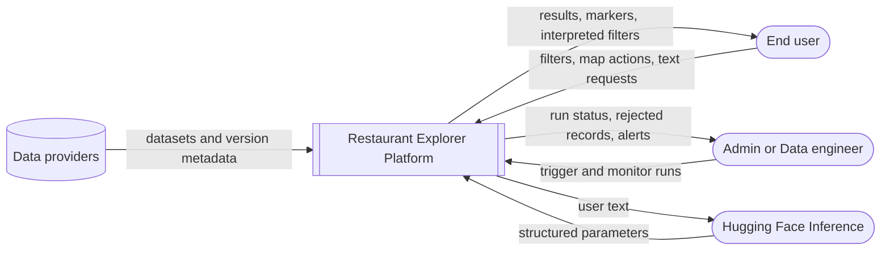
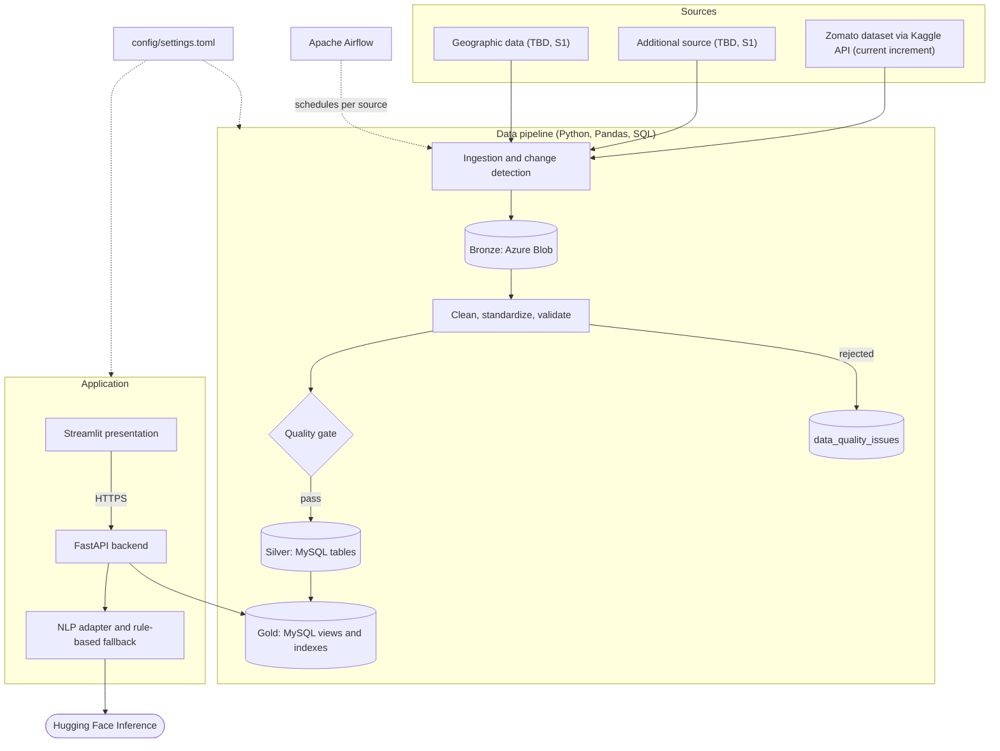
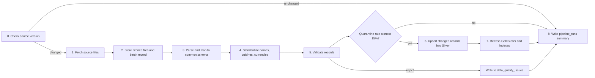
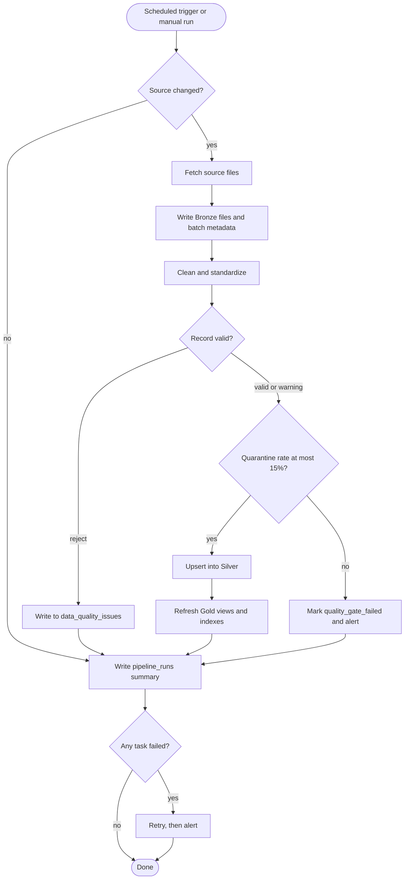
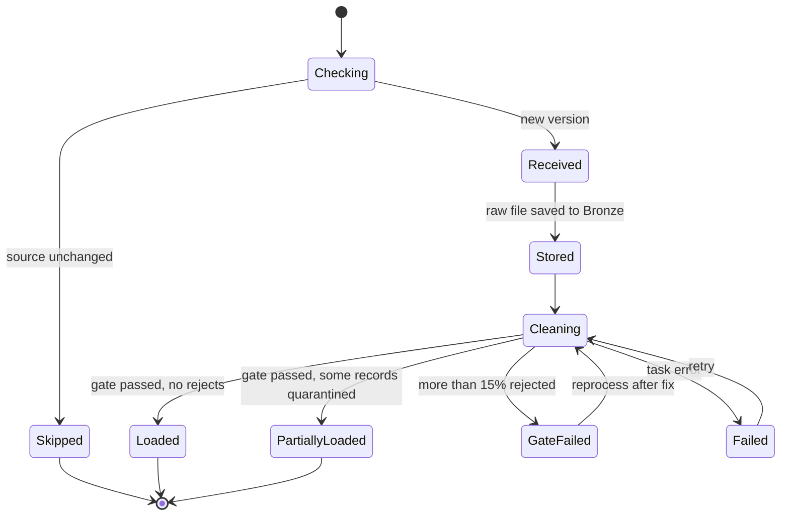
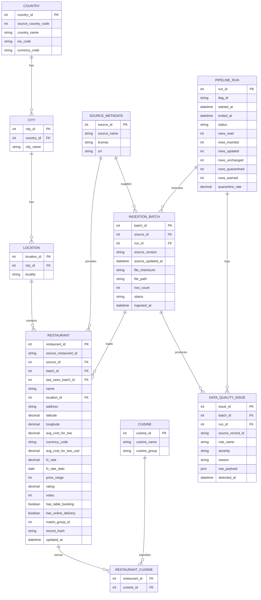
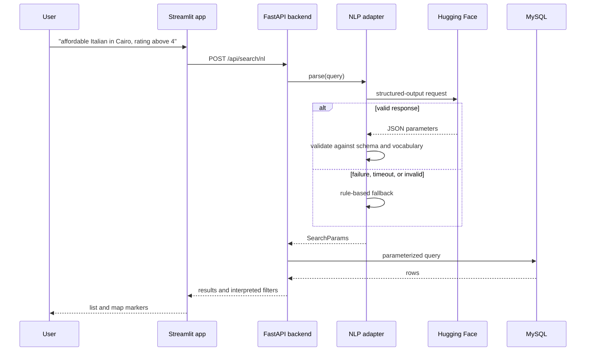
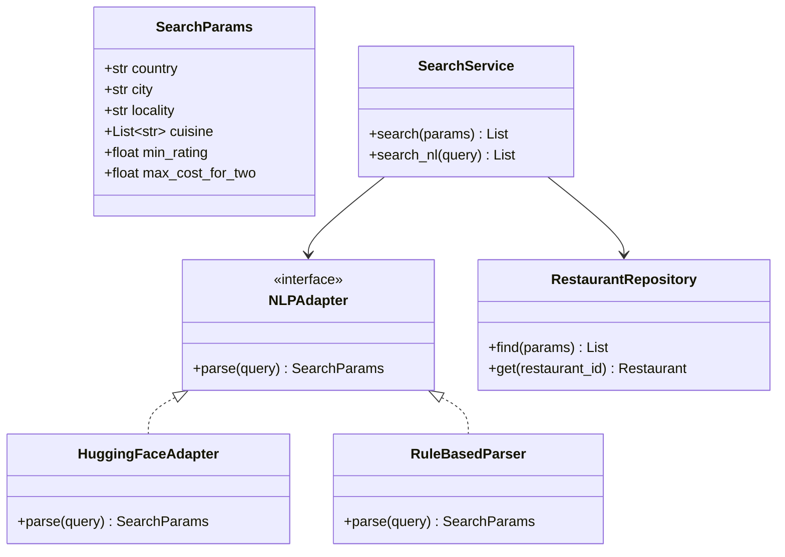
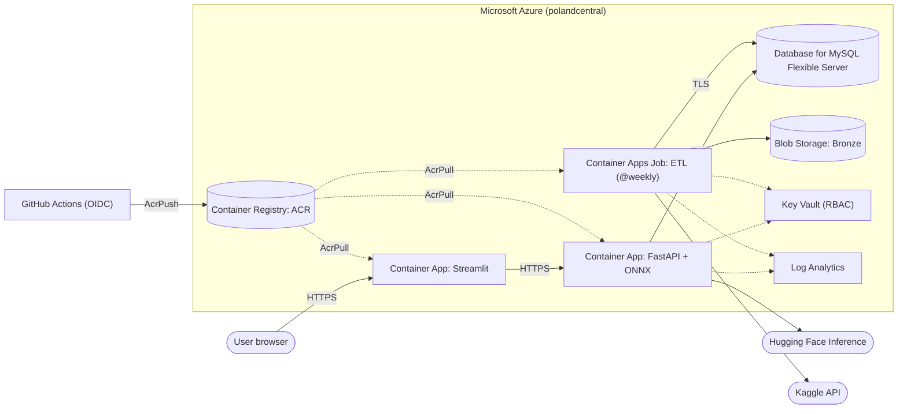

# Architecture and Design

> **Status:** Draft v0.6, a living document. Items marked **TBD** depend on Increment 2 spikes (S1) and may change. Diagrams use Mermaid and render on GitHub and in local preview extensions that support it.
> **Last updated:** 2026-11-26

## 1. Goals and constraints

- Reconcile several restaurant datasets into one trustworthy MySQL model hosted on Azure. The current increment ingests the Zomato dataset only; a second source follows in a later increment (see `docs/DATA_SOURCES.md`).
- Keep every pipeline step idempotent, observable, and re-runnable.
- Fetch every source by code on its own schedule, and load only what changed.
- Serve filters, map, and NLP search through a thin FastAPI backend.
- Keep the NLP provider swappable, with a rule-based fallback.
- Constraints: 6 students, build window about 15-30 Nov, Azure credits and cost limits, open or permitted data only (see `docs/PROJECT_PLAN.md`).

### 1.1 Design scope and capacity

The architecture is sized for the following, and these targets are part of the design rather than limitations to apologize for:

| Dimension | Target |
| --- | --- |
| Restaurants at MVP | About 10,000 (Zomato: 9,551 rows) |
| Design ceiling | Up to 100,000 restaurants on one MySQL Flexible Server and Pandas in memory |
| Concurrent users | 5-20 during demos and evaluation |
| Filtered search latency | Under 2 seconds for a typical query |
| Availability | 95% for the backend and Streamlit app (initial goal) |

Growing past the ceiling (for example loading all of Overture Maps) needs a design review: chunked or out-of-core processing and a revisited database tier. Big-data tooling is out of scope until then.

## 2. Architecture style

- **Data:** Medallion (Bronze, Silver, Gold) batch pipeline orchestrated by Apache Airflow.
- **Application:** three tiers (Streamlit presentation, FastAPI service layer, MySQL data layer) in a modular monolith backend. Microservices are unnecessary at this scale.
- **Principles:** idempotent tasks, provenance on every record, check sources before downloading, validate before load, quarantine instead of delete, a quality gate before publishing, secrets in environment variables, non-secret settings in one committed file (`config/settings.toml`), business logic kept out of DAG files.

## 3. System context (DFD Level 0)



## 4. Component view



The Streamlit presentation layer (`web/streamlit/`) interacts with the FastAPI backend strictly over HTTP/HTTPS via `web/streamlit/api_client.py`. The Streamlit app holds no database credentials, embeds no SQL, and never imports `pymysql`, `sqlalchemy`, or backend/pipeline modules directly.

## 5. Medallion layers

| Layer | Stored in | Contents | Rules |
| ------- | ----------- | ---------- | ------- |
| Bronze | Azure Blob Storage | Original files organized by source, ingestion date, and batch ID, plus batch metadata (source version, checksum) | Append-only, never modified; enables reprocessing |
| Silver | MySQL | Cleaned and standardized restaurants, cities, countries, localities, cuisines; quarantine table; operational tables | Validated, deduplicated, standardized names; loaded incrementally |
| Gold | MySQL | Search table, aggregate views, map points, indexes | Built from Silver by SQL; optimized for the app |

## 6. Data flow (DFD Level 1: pipeline)



| Stage | Responsibility | Idempotency approach |
| ------- | ---------------- | ---------------------- |
| Check | Read source version metadata; compare with the last successful batch | Unchanged source ends the run as `skipped_unchanged` |
| Fetch and Bronze | Download sources by code; save with batch ID and checksum | Files keyed by source and batch; a known checksum is not loaded twice |
| Standardize | Map each source schema to the common model | Deterministic mapping tables (`docs/CUISINE_VOCABULARY.md`) |
| Validate | Rules in `docs/DATA_QUALITY_RULES.md` | Failures written, never dropped |
| Quality gate | Stop publishing if more than 15% of records are rejected | Run marked `quality_gate_failed`; Bronze kept for reprocessing |
| Load | Upsert on `(source_id, source_restaurant_id)`; skip records whose hash is unchanged | Re-run yields the same state |
| Gold refresh | Rebuild or refresh views and indexes | Safe to repeat |
| Report | Row counts by outcome, quarantined and warned counts by rule | One row per run |

### 6.1 Change detection and incremental loads

Incremental processing is a Must requirement (FR-D7) and works at two levels:

1. **Source level.** Before downloading, the pipeline compares the source's version metadata (for Kaggle: dataset version and last-updated date) with the last successful batch, then compares the file checksum. If either matches, nothing is loaded.
2. **Record level.** Each Silver restaurant stores a `record_hash` of its standardized business fields. On load, new keys are inserted, changed hashes are updated, and unchanged records are only counted. `last_seen_batch_id` records the latest batch that contained the restaurant; rows missing from a newer snapshot are kept (whether Gold hides them is open question DS-3 in `docs/DATA_SOURCES.md`).

## 7. Activity: scheduled pipeline run



### 7.1 Schedules per source

Each source has its own DAG schedule and change test. Schedules are values in `config/settings.toml` (`[sources.<name>] schedule`).

| Source | Status | Schedule | Loads when |
| --- | --- | --- | --- |
| Zomato (Kaggle) | Current increment | `@weekly` | Kaggle dataset version or last-updated date changed, and the file checksum is new |
| Overture Maps Places | Candidate | `@monthly` | A new release is published |
| Foursquare OS Places | Candidate | `@monthly` | A new monthly release is available |
| OpenStreetMap extract | Candidate | Decided at integration | The extract timestamp changed |
| Geographic boundaries | Candidate | Manual (`@once`, re-run on demand) | Provider version changed |

A run that finds no change is recorded as `skipped_unchanged` and counts as a successful run for data freshness (section 11.4).

## 8. State: ingestion batch



## 9. Data model (draft ERD)

Based on the team's proposed tables, extended for currency standardization, incremental loads, and the quality gate. Spatial storage and USD price normalization follow `docs/CODE_STYLE.md` (sections 2 and 4). Cross-source matching (`match_group_id`) is kept as a placeholder column; its method is decided when a second source is added (D-4).



**Normalization notes:** cuisines are a many-to-many relation (the source stores them as one comma-separated field). Countries, cities, and localities are split to avoid repeating text. The country carries its ISO currency code; each restaurant row also keeps the original amount and code, as `CODE_STYLE.md` requires for Silver.

**Status values:** `pipeline_runs.status` is one of `success`, `skipped_unchanged`, `quality_gate_failed`, `failed`. `data_quality_issues.severity` is `reject` or `warning` (`docs/DATA_QUALITY_RULES.md`).

**Gold objects (planned):** `gold_restaurant_search` (denormalized, indexed), `gold_map_points`, `gold_city_cuisine_stats`, `gold_locality_cost`, `gold_rating_distribution`.

**Indexes (planned):** composite on city, price_range, and rating; index on cuisine join keys; full-text on name; a spatial index on the Gold map table's `POINT SRID 4326` column.

### 9.1 Enrichment and inference

### Derived during standardization (current increment)

| Field | Derived from | Rule |
| --- | --- | --- |
| `country_id`, country name | Zomato numeric `Country Code` | Country lookup |
| `currency_code` (ISO 4217) | Country | The free-text currency label is not trusted (`Dollar($)` is shared by several countries) |
| `avg_cost_for_two_usd`, `fx_rate`, `fx_rate_date` | Original amount and currency | One FX source, rate pinned per batch |
| `rating = NULL` | Rating `0` with text `Not rated` | Unrated is never stored as `0` |
| Canonical cuisine and cuisine group | Comma-separated cuisine field | `docs/CUISINE_VOCABULARY.md` |
| Map point | Valid latitude and longitude | Built only in Gold; invalid coordinates become `NULL` in Silver |
| `record_hash` | Standardized business fields | Change detection for incremental loads |

**Not inferred (explicitly out of scope for now):** coordinates are never imputed; locality is never reverse-geocoded (Zomato supplies it); missing cost, rating, or cuisine values are never estimated; price range is taken from the source, not recomputed. Cross-source enrichment (for example adding phone or website from a matched Overture record) is deferred as a low-priority decision (D-8).

## 10. NLP search design

**Approach:** constrained extraction. The model fills a fixed parameter object and never writes SQL.

```text
SearchParams {
  country?: string
  city?: string
  locality?: string
  cuisine?: string[]
  min_rating?: number
  min_cost_for_two?: number
  max_cost_for_two?: number
  price_range?: 1..4
  needs_clarification?: string
}
```

### Components

- **Adapter interface:** `parse(query) -> SearchParams`, with a Hugging Face `InferenceClient` implementation (`HuggingFaceAdapter`) and a local Hugging Face ONNX semantic hybrid (`HFOnnxSemanticMatcher` using `sentence-transformers/all-MiniLM-L6-v2` + `RuleBasedParser`).
- **Validation:** output checked against the schema and the vocabulary of known countries, cities, localities, and canonical cuisines. Unknown values are dropped or flagged.
- **Fallback:** on timeout (`[nlp] timeout_seconds`, 5 seconds), error, `402`/`429`, or invalid output, fall back to the local `all-MiniLM-L6-v2` ONNX semantic hybrid + deterministic rules (or pure regex rules if the ONNX model is unavailable). In the local parser, off-topic non-dining prompts are rejected via a domain gate, longer cuisine names take precedence over overlapping shorter ones (e.g., `"North Indian"` vs. `"Indian"`), city aliases/minor typos are normalized, and unknown explicit `in`/`near`/`around`/`on`/`at <place>` locations return `needs_clarification` instead of unfiltered results.
- **Clarification:** ambiguous, off-topic, or unsupported-location requests return a question for the user.
- **Follow-up refinement:** `POST /api/search/nl` accepts optional `previous_params` (`SearchParams`) so multi-turn follow-up prompts (e.g., `"restaurants in India"` -> `"in New Delhi"` -> `"North Indian rated above 4.2"`) merge statelessly onto active filters with clean location-hierarchy overrides and explicit `"New search"` / `"start over"` resets.
- **Cache:** repeated queries reuse parsed results.
- **Transparency:** the UI shows the interpreted filters.



### Backend classes (outline)



## 11. Security and operations

### 11.1 Security

- The Streamlit app never connects to MySQL and holds no database credentials; it accesses data exclusively through the FastAPI backend over HTTP/HTTPS via `web/streamlit/api_client.py`.
- Parameterized queries only; model output is never executed.
- The backend uses a read-only application account; the pipeline uses a separate write account.
- HTTPS everywhere; CORS limited to the Streamlit presentation origin.
- MySQL firewall rules allow Azure services (Container Apps & Scheduled Job) with verified TLS (`MYSQL_TLS_ENABLED=TRUE`); temporary deployer IP rules are removed after schema bootstrap. Private networking is a Could item.
- Airflow web interface restricted to team members.
- Rate limiting on the NLP endpoint to control cost.
- User NLP text is logged only truncated to 220 characters.

### 11.2 Configuration and secrets

Full rules: `docs/SECRETS.md`.

- **Secrets and environment-specific values** are environment variables: `.env` locally, GitHub Actions Secrets in CI, Azure Key Vault references in production. `.env.example` catalogues them.
- **Tunable non-secret settings** (timeouts, limits, thresholds, schedules, dataset identifiers, paths) live in one committed file, `config/settings.toml`.
- Each app reads both through its own settings module and fails fast if a secret is missing.
- **Airflow** receives connections as Docker-injected `AIRFLOW_CONN_*` variables (composed from `.env` locally; from Key Vault in production) and uses native hooks and sensors (`MySqlHook`, `WasbHook`, `WasbBlobSensor`). DAG files contain connection IDs only.

### 11.3 Observability and alerting

- **Structured logs:** pipeline and backend log JSON lines with `timestamp` (UTC), `level`, `logger`, `message`, and context fields when present (`run_id`, `batch_id`, `source_id`, `rule_name`, `request_id`). Secrets are never logged.
- **Run records:** `pipeline_runs` and `data_quality_issues` give per-run and per-rule counts.
- **Health:** `GET /api/health` returns `{"status": "ok"}` for the Azure Container Apps health probe.

| Alert condition | Threshold | Action |
| --- | --- | --- |
| Quality gate | Quarantine rate above 15% | Run marked `quality_gate_failed`; Silver and Gold not updated; alert |
| Task failure | A task fails after its retries | Airflow failure callback (local) / ACA Job failed execution status (prod) |
| Data staleness | No successful run (including `skipped_unchanged`) for more than 7 days | Alert; the app shows a staleness notice |
| Backend health | `GET /api/health` failing | Azure Container Apps restarts the replica |

The alert channel (email or chat webhook) is configured in Airflow during deployment.

### 11.4 Availability and freshness

- **Availability:** 95% target for the backend and Streamlit app (initial goal).
- **Freshness:** Gold data is considered stale when the last successful pipeline run for its source is more than 7 days old (`[freshness] gold_max_age_days`). The Streamlit app shows the last refresh time as a caption and a notice when data is stale.
- **Backend unreachable:** the Streamlit app shows a plain maintenance message (Could, scheduled late in the project).

## 12. Deployment view



| Azure service | Purpose | Priority |
| --------------- | --------- | ---------- |
| Database for MySQL Flexible Server (`Standard_B1ms`) | Silver & Gold database (TLS required) | Must |
| Blob Storage (`Standard_LRS`) | Bronze raw files (`bronze` container) | Must |
| Azure Container Apps (`WorkloadProfiles` Consumption) | FastAPI backend (`ca-eatosphere-backend`) & Streamlit UI (`ca-eatosphere-streamlit`) | Must |
| Azure Container Apps Scheduled Job | Weekly batch ETL (`job-eatosphere-etl`, `@weekly` cron) | Should |
| Azure Container Registry (`Basic`) | Stores `backend`, `streamlit`, and `pipeline` images | Must |
| Key Vault (RBAC) | Secrets accessed via Managed Identity (`id-eatosphere-prod`) | Should |
| Log Analytics | Container Apps & Job execution logs | Could |

Each deployed container ships `config/settings.toml` with its code. The backend and the Streamlit app are deployed together from the same commit (section 15). Local development and Airflow DAG orchestration remain supported via the Docker Compose stack (`docker-compose.yml`).

If Azure access or cost blocks any Must item, the fallback is local MySQL and Docker for the demo, documented honestly (spike S4).

## 13. Technology stack

| Layer | Technology | Status |
| ------- | ------------ | -------- |
| Language | Python | Decided |
| Data processing | Pandas, SQL | Decided |
| Database | MySQL on Azure Flexible Server | Decided |
| Raw storage | Azure Blob Storage | Decided |
| Source access | Kaggle API for the Zomato dataset | Decided |
| Orchestration | Azure Container Apps Scheduled Job (`@weekly` in prod); Apache Airflow 3.x (local Docker Compose) | Decided (D-2) |
| Backend | FastAPI | Decided |
| Web presentation | Streamlit (accesses data via FastAPI over HTTP) | Decided |
| NLP | Hugging Face `all-MiniLM-L6-v2` ONNX semantic hybrid + `InferenceClient` | Decided (D-3) |
| Configuration | Environment variables for secrets; `config/settings.toml` for settings | Decided |
| Hosting | Azure Container Apps (`WorkloadProfiles` Consumption), ACR, Key Vault | Decided |
| Version control | Git and GitHub | Decided |

## 14. UI/UX

Visual identity, layout, data-honesty presentation, and accessibility rules are in `docs/UI_UX.md`. Supported browsers: current stable Chrome, Edge, and Firefox. Initial screens: home with search, filters and results, map view, NLP search with interpreted filters, and a pipeline status page (Should).

## 15. API outline (draft)

| Method and path | Purpose | Priority |
| ----------------- | --------- | -------- |
| GET `/api/restaurants` | Filtered, paginated search | Must |
| GET `/api/restaurants/{restaurant_id}` | Restaurant details | Must |
| GET `/api/map/points` | Markers for the current filters or map bounds | Must |
| POST `/api/search/nl` | Natural-language search | Must |
| GET `/api/meta/countries`, `/api/meta/cities`, `/api/meta/cuisines` | Values for filter controls | Must |
| GET `/api/health` | Liveness for deployment health checks | Must |
| GET `/api/pipeline/status` | Latest run per source, freshness, and per-rule quality counts | Should |

FastAPI generates interactive API documentation automatically, which can serve as the API documentation deliverable.

**Change policy:** the API has no version prefix. The backend and the Streamlit app deploy together from the same commit, so a breaking change updates the backend, `web/streamlit/api_client.py`, and tests in one pull request. Old handling code is migrated in that change, not kept alongside a second version.

## 16. Open decisions

| ID | Decision | Depends on | Status |
| ---- | ---------- | ------------ | ------ |
| D-1 | Additional source(s) | S1 | Open; the current increment uses Zomato only |
| D-2 | Airflow / ETL hosting | S2 | Closed: Production ETL runs on Azure Container Apps Scheduled Job (`job-eatosphere-etl`, `@weekly` cron) within the \$100 Student budget; Apache Airflow 3.x DAG orchestration is supported via Docker Compose |
| D-3 | Hugging Face model and provider | S3 | Closed: `sentence-transformers/all-MiniLM-L6-v2` ONNX semantic hybrid always-on (`$0`, `30/30` Spike S3, `P95=89.7 ms`, `+185.7 MB RSS`) + `HuggingFaceAdapter` (`Qwen/Qwen3-32B`, `provider="auto"`) ready for free custom provider keys |
| D-4 | Cross-source matching method | Second source | Open; `match_group_id` kept as a placeholder |
| D-5 | Spatial storage and indexing | | Closed: `POINT SRID 4326` with a spatial index in Gold (`CODE_STYLE.md`, section 4) |
| D-8 | Cross-source enrichment (matched records enrich each other, or stay separate) | Second source | Deferred, low priority |
| D-9 | Category and cuisine mapping table for other sources | Second source | Deferred, low priority (`docs/CUISINE_VOCABULARY.md`, section 4) |

## 17. Change log

| Date | Change |
| --- | --- |
| 2026-10-30 | v0.1 created |
| 2026-11-20 | v0.3: adopted Streamlit as the primary web presentation framework and updated application and deployment views |
| 2026-11-23 | v0.4: codified Option A data access (Streamlit accesses data exclusively via FastAPI over HTTP through `web/streamlit/api_client.py`, holding no database credentials); updated component view, security notes, and status header |
| 2026-11-26 | v0.5: closed D-3 / Spike S3 with `all-MiniLM-L6-v2` ONNX semantic hybrid + `InferenceClient` two-tier NLP, off-topic domain gate, and stateless `previous_params` follow-up refinement |
| 2026-11-24 | v0.5: design scope and capacity (100K restaurants, 5-20 users, 95% availability); per-source schedules with check-before-download and Kaggle API fetch; incremental loads (FR-D7 Must); 15% quality gate; ERD extended (currency and USD fields, `record_hash`, `last_seen_batch_id`, batch version and checksum, run outcome counts, issue severity, cuisine group); enrichment and inference section; configuration and secrets split; Airflow `AIRFLOW_CONN_*` connections; JSON logs, alert thresholds, 7-day freshness; `GET /api/health`; pipeline status promoted to Should; API change policy; supported browsers; D-5 closed; D-8 and D-9 added |
