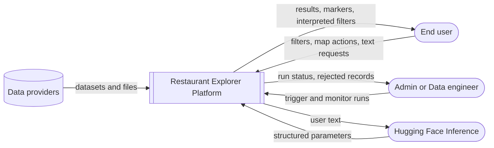
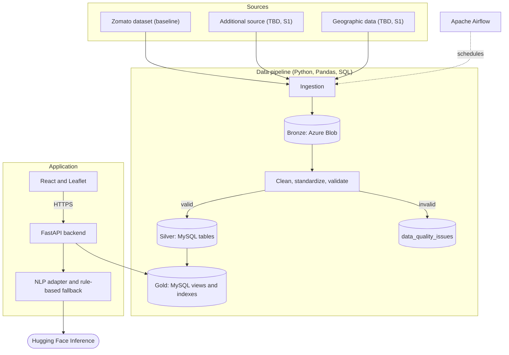
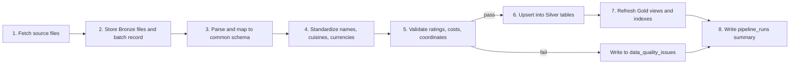
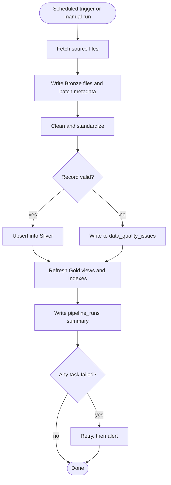
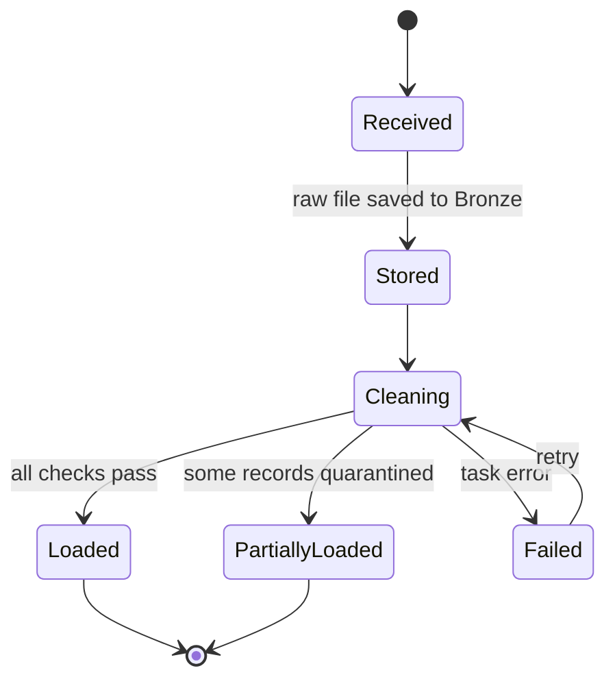
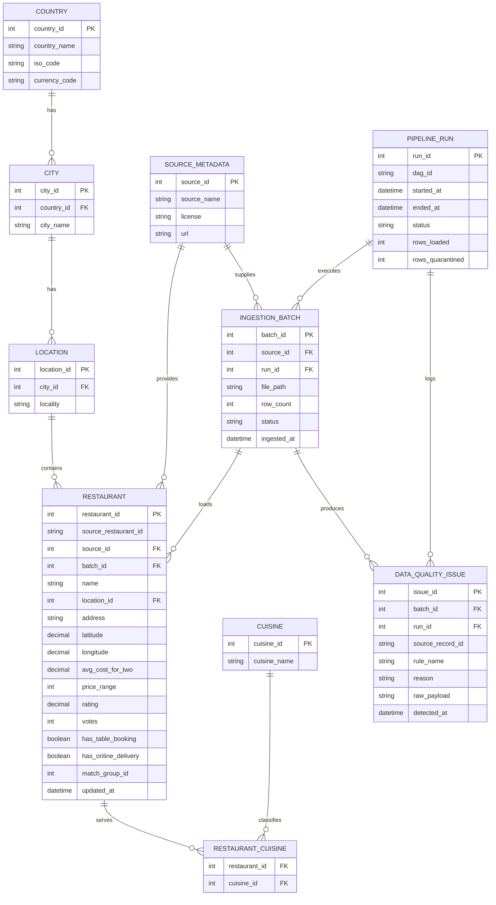
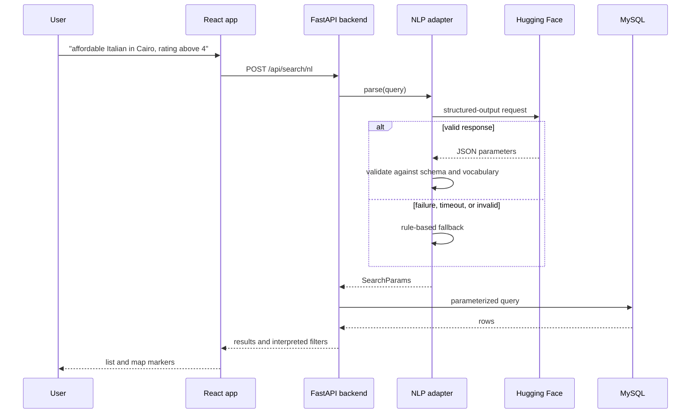
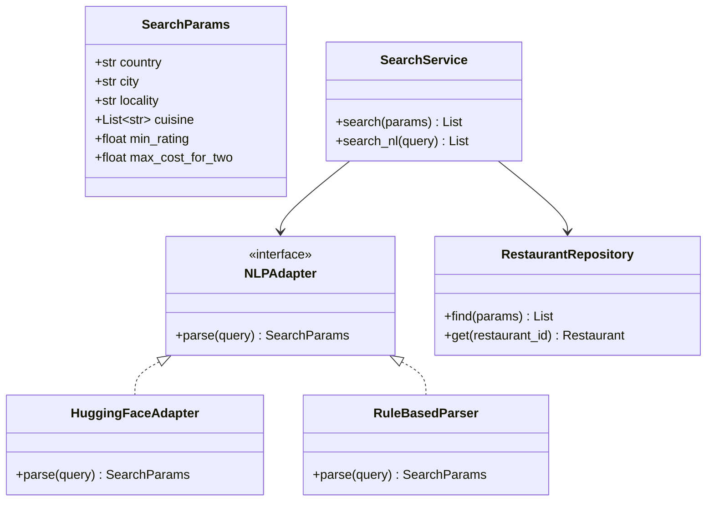
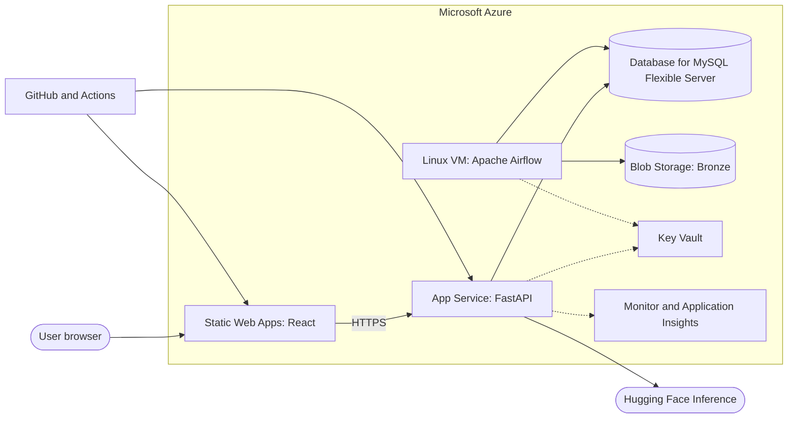

# Architecture and Design

> **Status:** Draft v0.2, a living document. Items marked **TBD** depend on spikes S1-S4 and may change. Diagrams use Mermaid and render on GitHub & local supported preview extensions.
> **Last updated:** 2026-10-30

## 1. Goals and constraints

- Reconcile several restaurant datasets into one trustworthy MySQL model hosted on Azure.
- Keep every pipeline step idempotent, observable, and re-runnable.
- Serve filters, map, and NLP search through a thin FastAPI backend.
- Keep the NLP provider swappable, with a rule-based fallback.
- Constraints: 6 students, build window about 15-30 Nov, Azure credits and cost limits, open or permitted data only (see `docs/PROJECT_PLAN.md`).

## 2. Architecture style

- **Data:** Medallion (Bronze, Silver, Gold) batch pipeline orchestrated by Apache Airflow.
- **Application:** three tiers (React presentation, FastAPI service layer, MySQL data layer) in a modular monolith backend. Microservices are unnecessary at this scale.
- **Principles:** idempotent tasks, provenance on every record, validate before load, quarantine instead of delete, configuration through environment variables, business logic kept out of DAG files.

## 3. System context (DFD Level 0)



## 4. Component view



## 5. Medallion layers

| Layer | Stored in | Contents | Rules |
| ------- | ----------- | ---------- | ------- |
| Bronze | Azure Blob Storage | Original files organized by source, ingestion date, and batch ID, plus batch metadata | Never modified; enables reprocessing |
| Silver | MySQL | Cleaned and standardized restaurants, cities, countries, localities, cuisines; quarantine table | Validated, deduplicated, standardized names |
| Gold | MySQL | Search table, aggregate views, map points, indexes | Built from Silver by SQL; optimized for the app |

## 6. Data flow (DFD Level 1: pipeline)



| Stage | Responsibility | Idempotency approach |
| ------- | ---------------- | ---------------------- |
| Fetch and Bronze | Download or read sources; save with batch ID | Files keyed by source and batch |
| Standardize | Map each source schema to the common model | Deterministic mapping tables |
| Validate | Required fields, ranges, coordinate bounds, duplicates | Failures written, never dropped |
| Load | Upsert on a stable source key | Re-run yields the same state |
| Gold refresh | Rebuild or refresh views and indexes | Safe to repeat |
| Report | Row counts, quarantined counts by reason | One row per run |

## 7. Activity: scheduled pipeline run



## 8. State: ingestion batch



## 9. Data model (draft ERD)

Based on the team's proposed tables. Open questions: price stored in local currency only or with a converted value, how to match the same restaurant across sources (`match_group_id`), and spatial indexing (see D-5).



**Normalization notes:** cuisines are a many-to-many relation (the source stores them as one comma-separated field). Countries, cities, and localities are split to avoid repeating text. Currency lives with the country.

**Gold objects (planned):** `gold_restaurant_search` (denormalized, indexed), `gold_map_points`, `gold_city_cuisine_stats`, `gold_locality_cost`, `gold_rating_distribution`.

**Indexes (planned):** composite on city, price_range, and rating; index on cuisine join keys; full-text on name; latitude and longitude (or a spatial column) for map bounds.

## 10. NLP search design

**Approach:** constrained extraction. The model fills a fixed parameter object and never writes SQL.

```
SearchParams {
  country?: string
  city?: string
  locality?: string
  cuisine?: string[]
  min_rating?: number
  min_cost_for_two?: number
  max_cost_for_two?: number
  price_range?: 1..4
  needs_clarification?: string
}
```

**Components**

- **Adapter interface:** `parse(query) -> SearchParams`, with a Hugging Face implementation and a rule-based implementation.
- **Validation:** output checked against the schema and the vocabulary of known countries, cities, localities, and cuisines. Unknown values are dropped or flagged.
- **Fallback:** on timeout, error, or invalid output, use the rule-based parser.
- **Clarification:** ambiguous or unsupported requests return a question for the user.
- **Cache:** repeated queries reuse parsed results.
- **Transparency:** the UI shows the interpreted filters.



**Backend classes (outline)**



## 11. Security

- The React app never connects to MySQL; only the backend does.
- Parameterized queries only; model output is never executed.
- Secrets (database password, Hugging Face key, Blob keys) are stored in Azure Key Vault or protected app settings, loaded from environment variables, and never committed.
- HTTPS everywhere; CORS limited to the frontend origin.
- MySQL firewall rules allow only the App Service, the Airflow host, and named developer IPs. Private networking is a Could item.
- Airflow web interface restricted to team members.
- Rate limiting on the NLP endpoint to control cost.

## 12. Deployment view



| Azure service | Purpose | Priority |
| --------------- | --------- | ---------- |
| Database for MySQL Flexible Server | Main database | Must |
| Blob Storage | Bronze raw files | Must |
| App Service | FastAPI backend | Must |
| Static Web Apps | React frontend | Must |
| Linux VM | Airflow host | Should |
| Key Vault | Secrets | Should |
| Monitor and Application Insights | Monitoring | Could |
| Virtual Network | Private networking | Could |

If Azure access or cost blocks any Must item, the fallback is local MySQL and Docker for the demo, documented honestly (spike S4).

## 13. Technology stack

| Layer | Technology | Status |
| ------- | ------------ | -------- |
| Language | Python | Decided |
| Data processing | Pandas, SQL | Decided |
| Database | MySQL on Azure Flexible Server | Decided |
| Raw storage | Azure Blob Storage | Decided |
| Orchestration | Apache Airflow | Decided (hosting TBD, S2) |
| Backend | FastAPI | Decided |
| Frontend | React, Leaflet (JavaScript or TypeScript TBD) | Decided |
| NLP | Hugging Face Inference Providers | Decided (model TBD, S3) |
| Hosting | Static Web Apps, App Service, Linux VM | Decided (VM Should) |
| Version control | Git and GitHub | Decided |

## 14. UI/UX

Wireframes, color and typography guidelines, and accessibility notes will go in `docs/UI_UX.md` (planned). Initial screens: home with search, filters and results, map view, NLP search with interpreted filters, optional pipeline status page.

## 15. API outline (draft)

| Method and path | Purpose |
| ----------------- | --------- |
| GET `/api/restaurants` | Filtered, paginated search |
| GET `/api/restaurants/{id}` | Restaurant details |
| GET `/api/map/points` | Markers for the current filters or map bounds |
| POST `/api/search/nl` | Natural-language search |
| GET `/api/meta/countries`, `/cities`, `/cuisines` | Values for filter controls |
| GET `/api/pipeline/status` | Latest run and quality stats (Could) |

FastAPI generates interactive API documentation automatically, which can serve as the API documentation deliverable.

## 16. Open decisions

| ID | Decision | Depends on |
| ---- | ---------- | ------------ |
| D-1 | Additional source(s) | S1 |
| D-2 | Airflow hosting | S2 |
| D-3 | Hugging Face model and provider | S3 |
| D-4 | Cross-source matching method | Sprint 2 |
| D-5 | Spatial indexing in MySQL | Sprint 1 |
| D-6 | Currency handling | Sprint 1 |
| D-7 | JavaScript vs TypeScript | Sprint 0 |

## 17. Change log

| Date | Change |
|------|--------|
| 2026-10-30 | v0.1 created |
| 2026-10-30 | v0.2: medallion layers, team schema, FastAPI and React, Azure deployment; added activity, state, and class diagrams |
