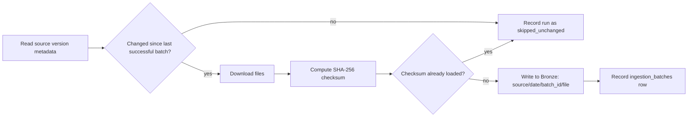

# Data Sources

> **Status:** Draft v0.1, a recommendation and not yet final. Only the Zomato source is in scope for the current increment; the other sources are candidates and are listed so that the pipeline design does not assume a single, one-time download.
> **Last updated:** 2026-11-24

This document describes each data source: how it is fetched, how often, how a change is detected, and how its files land in Bronze. Quality rules are in [`DATA_QUALITY_RULES.md`](DATA_QUALITY_RULES.md); the cuisine vocabulary is in [`CUISINE_VOCABULARY.md`](CUISINE_VOCABULARY.md); the schedule summary is in [`ARCHITECTURE.md`](ARCHITECTURE.md), section 7.

## 1. Principles

1. **Fetched by code, never by hand.** Every source is downloaded by a pipeline module. Nobody downloads a file manually and copies it into the repository or into Bronze. This applies to the Kaggle snapshot too.
2. **Each source has its own cadence.** A source is checked on its own schedule and loaded only when it has changed. There is no single global schedule.
3. **Check before download.** The pipeline first reads the source's version metadata. If the version matches the last successful batch, the run ends early with status `skipped_unchanged`, which counts as a successful run for data-freshness purposes.
4. **Bronze is append-only.** A changed source produces a new batch folder. Earlier batches are never overwritten, so any batch can be reprocessed.
5. **Incremental by default.** Silver loads upsert on `(source_id, source_restaurant_id)` and compare a per-record hash, so unchanged records are counted but not rewritten (FR-D7).
6. **Settings live in config.** Dataset identifiers, schedules, file names, and encodings are non-secret values in `config/settings.toml`; credentials are environment variables (see [`SECRETS.md`](SECRETS.md)).

## 2. Common ingestion flow

The checksum test is a second guard for sources whose metadata changes without a content change.

**Bronze path:** `<source>/<yyyy-mm-dd>/<batch_id>/<original_file>` (from `CODE_STYLE.md`, section 8), for example `zomato/2026-11-24/b0007/zomato.csv`.

**Batch record:** each batch stores `source_id`, `source_version`, `source_updated_at`, `file_checksum`, `file_path`, `row_count`, and `status` (see the ERD in `ARCHITECTURE.md`).

## 3. Sources

### 3.1 Zomato restaurants (Kaggle): in scope

| Item | Value |
| --- | --- |
| Role | Baseline dataset for the current increment |
| Dataset | Kaggle dataset identifier in `config/settings.toml` (`[sources.zomato] kaggle_dataset = "shrutimehta/zomato-restaurants-data"`, confirmed per DS-1) |
| Files | `zomato.csv` (restaurants). All 15 numeric `Country Code` ISO/currency mappings are seeded deterministically in `sql/001_create_tables.sql` and `constants.py` |
| Access | Kaggle API using `KAGGLE_USERNAME` and `KAGGLE_KEY` (secrets, see `SECRETS.md`) |
| License | CC0 1.0 for the upload reviewed in `LITERATURE_REVIEW.md`; record it in `source_metadata.license` |
| Update pattern | Rarely updated snapshot |
| Cadence | **Weekly check** (`@weekly`); load **only if** the dataset version or last-updated date changed |
| Change detection | Kaggle dataset version and last-updated date, then the file checksum |
| Bronze behavior | New batch folder per changed version; never overwrite |
| Encoding | Not UTF-8. The current file decodes as Latin-1 but contains mojibake (for example `Pounds(��)`, `D�_ner`). The ingestion module reads with an explicit encoding from config and repairs known sequences; see `DATA_QUALITY_RULES.md` |

**Observed profile of `data/zomato.csv`** (local copy, used only to shape rules; not a substitute for the scheduled fetch):

| Fact | Value |
| --- | --- |
| Rows | 9,551 |
| Columns | 21 (`Restaurant ID`, `Restaurant Name`, `Country Code`, `City`, `Address`, `Locality`, `Locality Verbose`, `Longitude`, `Latitude`, `Cuisines`, `Average Cost for two`, `Currency`, `Has Table booking`, `Has Online delivery`, `Is delivering now`, `Switch to order menu`, `Price range`, `Aggregate rating`, `Rating color`, `Rating text`, `Votes`) |
| Countries | 15 country codes; 8,652 rows (about 91%) are India (`1`) |
| Currencies | 12 currency labels. `Dollar($)` is shared by several countries, so the label alone cannot identify the currency |
| Unrated | 2,148 rows have rating `0` with rating text `Not rated` |
| Coordinates | 499 rows have latitude or longitude equal to `0` |
| Cost | 18 rows have average cost for two equal to `0` |
| Cuisines | 9 rows have no cuisine; 145 distinct cuisine labels |
| Duplicates | No duplicate `Restaurant ID` values |
| Price range | Values 1-4 only |

**Removed records.** If a later Zomato version drops a restaurant, the Silver row is kept and its `last_seen_batch_id` stops advancing. Whether Gold hides such rows is an open question (section 5).

### 3.2 Candidate sources: not yet integrated

These are recorded so the design supports them. Integration, field mapping, license routing, and cross-source matching are deferred until a second source is chosen (spike S1, decision D-1).

| Source | Update pattern | Recommended cadence | Change detection | Access |
| --- | --- | --- | --- | --- |
| Overture Maps Places | Periodic releases (roughly monthly) | Monthly check for a new release | Release identifier in the published path | Public cloud storage, GeoParquet |
| Foursquare OS Places | Monthly refresh | Monthly check | Release date or version | Registration required; portal or Hugging Face route |
| OpenStreetMap (regional extract) | Continuous edits; extracts refreshed regularly | Weekly or monthly, decided at integration | Extract timestamp | Public regional extracts |
| Geographic boundaries | Occasional | Manual trigger (`@once` plus re-run on demand) | Provider version | Depends on provider |

## 4. Adding a source (checklist)

1. Record the source, license, and attribution requirement in this document and in `source_metadata`.
2. Add its identifier, cadence, file names, and encoding to `config/settings.toml` under `[sources.<name>]`.
3. Add any credential to `.env.example` and `docs/SECRETS.md`.
4. Implement fetch, change detection, and Bronze write in `pipeline/ingestion/`.
5. Map its fields to the Silver schema and extend the quality rules and cuisine or category mapping.
6. Add its DAG schedule to `ARCHITECTURE.md`, section 7.

## 5. Open questions

| ID | Question | When |
| --- | --- | --- |
| DS-1 | Closed: confirmed Kaggle slug `shrutimehta/zomato-restaurants-data`; all 15 country codes seeded in schema and constants | Resolved |
| DS-2 | Confirm whether additional mojibake repairs beyond `Pounds(£)`, `Döner`, `Börek`, and `İstanbul` appear in future Zomato snapshots | Ongoing during ingestion monitoring |
| DS-3 | Should Gold hide restaurants no longer present in the latest batch of their source? | After the Zomato increment works end to end |
| DS-4 | Delta detection for large candidate sources (file-level only, or record-level change feeds) | When a second source is chosen |

## 6. Change log

| Date | Change |
| --- | --- |
| 2026-11-24 | v0.1 created as a recommendation draft: per-source cadence, check-before-download, Kaggle API fetch, append-only Bronze, Zomato profile, candidate sources |
