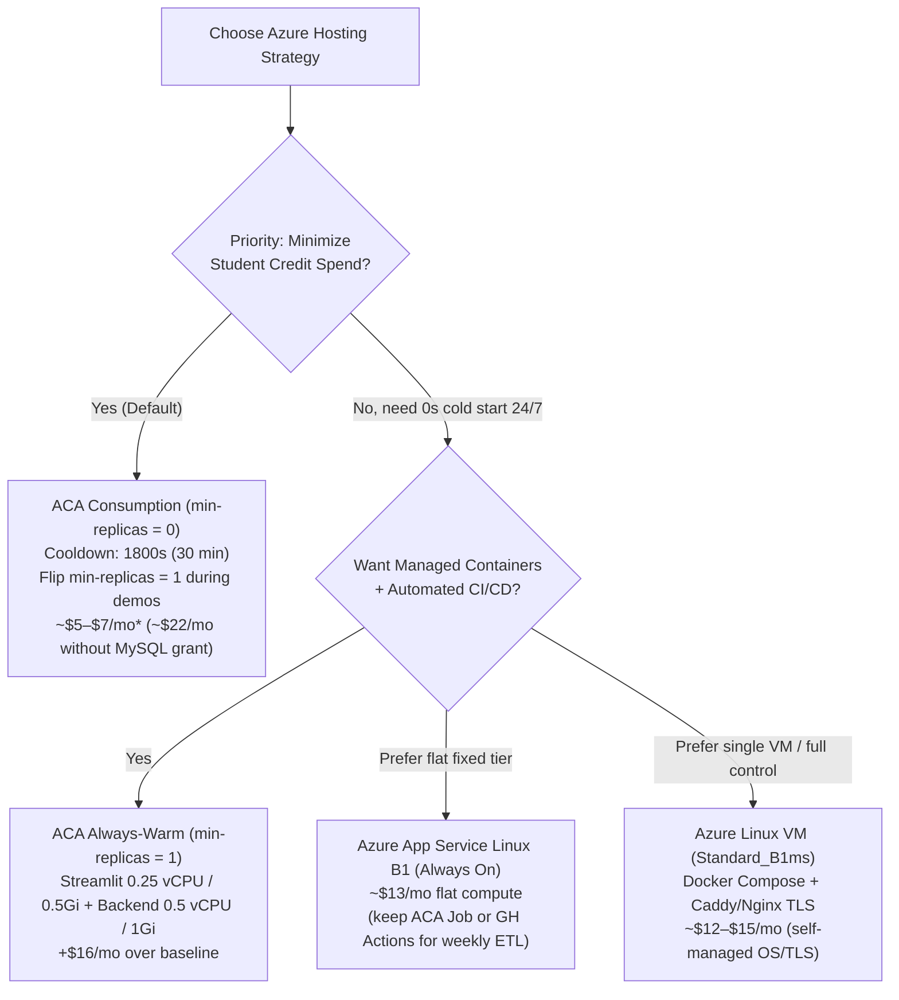
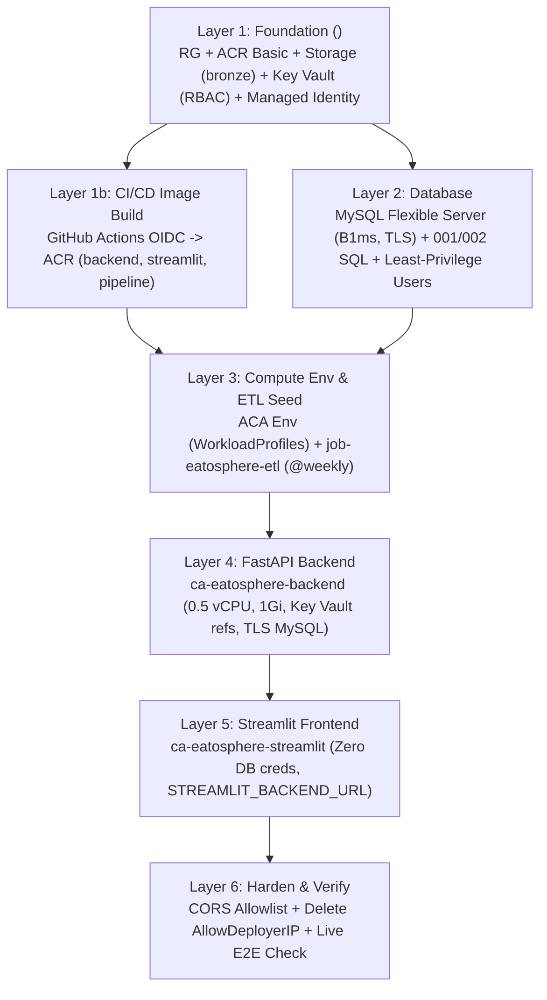
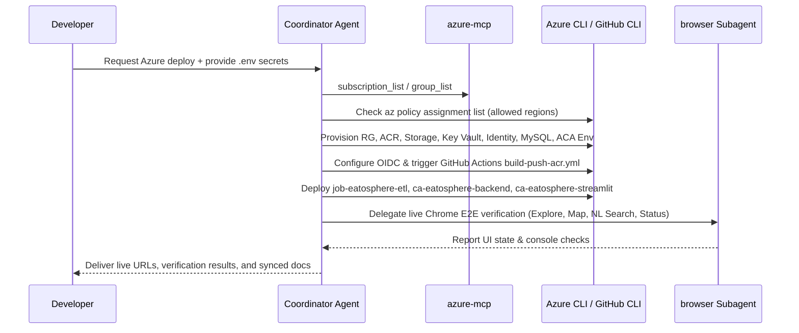

# Production Deployment Guide on Microsoft Azure

> **Last updated:** 2026-11-27  
> **Target Environment:** Microsoft Azure (`Azure for Students`, \$100 credit budget)  
> **Portability Note:** Anyone can deploy this repository to their own Azure subscription and GitHub fork. Globally unique resource names (ACR, Storage Account, Key Vault, MySQL server) and generated Container Apps URLs will differ per deployment — replace `<suffix>`, `<your-region>`, and `<your-...-fqdn>` with your own values.

### Reference Demo Deployment (`polandcentral`)

- **Streamlit Web App:** <https://ca-eatosphere-streamlit.politeriver-19c81647.polandcentral.azurecontainerapps.io>
- **FastAPI Backend & OpenAPI:** <https://ca-eatosphere-backend.politeriver-19c81647.polandcentral.azurecontainerapps.io/docs>

This guide provides **three independent deployment tracks** — pick whichever matches your workflow:
- **Track A — Manual CLI Workflow (Without MCPs/Agents):** Reproducible PowerShell/Bash `az` + `gh` scripts.
- **Track B — Agentic / MCP-Assisted Workflow:** Delegated setup using AI coding agents, `azure-mcp`, and the `browser` subagent.
- **Track C — Manual Web UI Workflow (Azure Portal + GitHub Web UI):** Point-and-click deployment directly through [portal.azure.com](https://portal.azure.com) with links to official Microsoft Learn guides.

---

## 0. Choosing a Deployment Strategy, Cold Starts & Cost Management

Before provisioning resources, pick the hosting profile that fits your budget and latency goals. This project defaults to **Azure Container Apps (Consumption, `min-replicas = 0`)** to maximize the \$100 Azure for Students credit, which trades a one-time cold start after idleness for near-\$0 idle compute.



### Alternative Approaches Comparison (`polandcentral` Retail Rates)

| Strategy | Cold Start | Warm Page Load | Est. Monthly Cost (`polandcentral`) | Trade-Offs |
| --- | --- | --- | --- | --- |
| **A. ACA Scale-to-Zero + 30-min Cooldown + Demo Warmup** *(Default in this guide)* | 15–25s on first visit after 30 min idle; **0s** during active sessions & demos | < 1–2s | **~\$5–\$7/mo** *(with 12-mo Student MySQL `B1ms` grant)* or **~\$22–\$24/mo** *(full retail)* | Best credit runway; chained cold start (Streamlit ~6–10s + Backend/ONNX ~8–15s) only after cooldown expires |
| **B. ACA Always-Warm** (`min-replicas = 1`, right-sized Streamlit `0.25 vCPU / 0.5 GiB`) | **0s** (always instant) | < 1–2s | Baseline **+ \$16.10/mo** *(or +\$22/mo at `0.5 vCPU / 1 GiB` each)* | Zero cold starts while keeping full per-service container isolation and CI/CD |
| **C. ACA Backend-Only Warm** (`min-replicas = 1` on backend only) | ~6–10s (Streamlit only) | < 1–2s | Baseline **+ \$10.20/mo** | Cuts cold start roughly in half at lower idle cost |
| **D. Azure App Service Linux `B1`** (`Always On` enabled) | **0s** | < 1–2s | **~\$13/mo** flat compute + MySQL/ACR/Storage | Predictable flat rate, but requires co-hosting or 2 plans and a separate scheduler for weekly ETL |
| **E. Single Azure Linux VM (`Standard_B1ms`)** + Docker Compose | **0s** | < 1–2s | **~\$12–\$15/mo** + storage | Full control & zero cold starts, but you manually manage OS updates, TLS certificates, and restarts |
| **F. Streamlit Community Cloud (Free) + Warm Azure Backend** | **0s** *(frontend sleeps only after days)* | < 1–2s | Baseline **+ \$10.20/mo** (backend only) | Free frontend hosting while keeping FastAPI, ONNX NLP, and MySQL securely on Azure |

### Tuning Cold Starts & Demo Warmup in Azure Portal (`App → Scale`)

To keep day-to-day costs low while guaranteeing **0s cold starts** during presentations or grading:

1. In [portal.azure.com](https://portal.azure.com), open **`rg-eatosphere-prod`** → **`ca-eatosphere-backend`** (and repeat for **`ca-eatosphere-streamlit`**).
2. In the left sidebar under **App**, click **Scale**.
3. Edit the fields directly in the **Scale rule settings** panel:
   - **Cooldown period:** set to **`1800`** (30 minutes, up from default `300`s) so once a user opens the app, it stays warm for the full session.
   - **Polling interval:** keep at **`30`** seconds.
   - **Before a demo / grading:** set **Min replicas** to **`1`** (`~\$0.03/hour` while warm for both apps).
   - **After the demo:** set **Min replicas** back to **`0`** to restore \$0 idle compute.
4. Click **Save** / deploy the updated revision (~30–60s).

### Cost Monitoring & Student Credit Alerts

- **Azure for Students credit balance:** Open **Azure Portal → Education → Overview** (or [microsoftazuresponsorships.com/Balance](https://www.microsoftazuresponsorships.com/Balance)). Note that Azure Cost Management's **Forecast** chart requires **2–3+ days** of metered billing history before showing projected spend on newly provisioned resources.
- **Budget alerts:** Open **Azure Portal → Cost Management → Budgets → + Add**, set a monthly cap (e.g., `\$25`), and configure email alerts at `50%`, `80%`, and `100%`.

---

## 1. Production Architecture & Bottom-Up Deployment Flow

Resources are provisioned **bottom-up** in strict dependency order so each layer receives validated endpoints and Managed Identity permissions from the layer below it:



### Target Resource Naming Template

Choose a short lowercase alphanumeric `<suffix>` (for example `2611` or your initials + digits) for globally unique Azure names:

| Layer | Resource Name Pattern | Tier / Sizing | Purpose |
| --- | --- | --- | --- |
| Resource Group | `rg-eatosphere-prod` | Allowed region (e.g., `polandcentral`) | Logical container for all resources |
| Container Registry | `acreatosphere<suffix>` | `Basic` (admin disabled) | Stores `backend`, `streamlit`, `pipeline` images |
| Blob Storage | `steatosphere<suffix>` | `Standard_LRS` (`bronze` container) | Append-only raw Kaggle Zomato batches |
| Key Vault | `kv-eatosphere-<suffix>` | `Standard` (RBAC enabled) | Holds 7 secrets accessed via Managed Identity |
| Managed Identity | `id-eatosphere-prod` | User-Assigned | `AcrPull`, `AcrPush` (OIDC), `Key Vault Secrets User` |
| MySQL Server | `mysql-eatosphere-<suffix>` | Burstable `Standard_B1ms`, 20 GB | MySQL `8.0.21`, TLS required |
| ACA Environment | `cae-eatosphere-prod` | `WorkloadProfiles` Consumption | Hosts Scheduled Job + Backend + Streamlit |
| ETL Job | `job-eatosphere-etl` | `0.5` vCPU, `1.0Gi` RAM, `@weekly` | Runs `pipeline:latest` (`0 3 * * 0` UTC) |
| Backend App | `ca-eatosphere-backend` | `0.5` vCPU, `1.0Gi` RAM, `0–2` replicas | FastAPI + pre-baked `all-MiniLM-L6-v2` ONNX |
| Streamlit App | `ca-eatosphere-streamlit` | `0.5` vCPU, `1.0Gi` RAM, `0–1` replicas | Editorial UI; zero DB credentials |

---

## 2. Track A: Manual CLI Workflow (Without MCPs or Agents)

### 2.1 Prerequisites

- [Azure CLI (`az`)](https://learn.microsoft.com/en-us/cli/azure/install-azure-cli) logged in (`az login`), plus the `containerapp` extension:

  ```powershell
  az extension add --name containerapp --upgrade -y
  ```

- [GitHub CLI (`gh`)](https://cli.github.com/) logged in (`gh auth login`)
- Python 3.12+ `.venv` with `pymysql` installed (for one-time TLS schema initialization)
- Valid `KAGGLE_USERNAME`, `KAGGLE_KEY`, and `HF_API_KEY` values ready locally

### 2.2 Step 1 — Check Allowed Regions, Register Providers & Provision Foundation

```powershell
$SUB = "<your-subscription-id>"
$SUFFIX = "<your-unique-suffix>"        # e.g., 2611 (lowercase alphanumeric)
$RG = "rg-eatosphere-prod"
$LOC = "polandcentral"                  # Verify with: az policy assignment list
$ACR = "acreatosphere$SUFFIX"
$ST = "steatosphere$SUFFIX"
$KV = "kv-eatosphere-$SUFFIX"
$ID = "id-eatosphere-prod"

az account set --subscription $SUB
az group create --name $RG --location $LOC

# Register required Azure resource providers (wait until all show 'Registered')
foreach ($ns in @("Microsoft.App","Microsoft.OperationalInsights","Microsoft.ContainerRegistry","Microsoft.DBforMySQL","Microsoft.KeyVault","Microsoft.Storage","Microsoft.ManagedIdentity")) {
  az provider register --namespace $ns
}

# 1. Container Registry
az acr create --name $ACR --resource-group $RG --sku Basic --admin-enabled false --location $LOC

# 2. Bronze Blob Storage
az storage account create --name $ST --resource-group $RG --location $LOC --sku Standard_LRS --kind StorageV2 --min-tls-version TLS1_2 --allow-blob-public-access false
$ST_KEY = az storage account keys list --resource-group $RG --account-name $ST --query "[0].value" -o tsv
az storage container create --name bronze --account-name $ST --account-key $ST_KEY

# 3. Key Vault (RBAC) + Admin role for deployer
az keyvault create --name $KV --resource-group $RG --location $LOC --enable-rbac-authorization true
$USER_ID = az ad signed-in-user show --query id -o tsv
$KV_ID = az keyvault show --name $KV --resource-group $RG --query id -o tsv
az role assignment create --assignee $USER_ID --role "Key Vault Secrets Officer" --scope $KV_ID

# 4. User-Assigned Managed Identity + RBAC
$ID_PRINCIPAL = az identity create --name $ID --resource-group $RG --location $LOC --query principalId -o tsv
$ACR_ID = az acr show --name $ACR --resource-group $RG --query id -o tsv
az role assignment create --assignee-object-id $ID_PRINCIPAL --assignee-principal-type ServicePrincipal --role AcrPull --scope $ACR_ID
az role assignment create --assignee-object-id $ID_PRINCIPAL --assignee-principal-type ServicePrincipal --role AcrPush --scope $ACR_ID
az role assignment create --assignee-object-id $ID_PRINCIPAL --assignee-principal-type ServicePrincipal --role "Key Vault Secrets User" --scope $KV_ID
# Optional (required for automated CD rollouts from GitHub Actions):
$RG_ID = az group show --name $RG --query id -o tsv
az role assignment create --assignee-object-id $ID_PRINCIPAL --assignee-principal-type ServicePrincipal --role Contributor --scope $RG_ID
```

Store the 7 required secrets in `$KV` (never echo secrets to terminal logs):
`mysql-admin-password`, `mysql-pipeline-password`, `mysql-app-password`, `azure-storage-connection-string`, `kaggle-username`, `kaggle-key`, and `hf-api-key`.

### 2.3 Step 2 — Build & Push Images via GitHub Actions OIDC

Because `Azure for Students` disables remote `az acr build` (`TasksOperationsNotAllowed`) and local `docker push` can time out on slow connections, [`.github/workflows/build-push-acr.yml`](../.github/workflows/build-push-acr.yml) builds and pushes all 3 `linux/amd64` images directly from GitHub Actions using OIDC:

```powershell
$OWNER = "<github-owner>"
$OWNER_ID = "<github-owner-numeric-id>"
$REPO = "<repo-name>"
$REPO_ID = "<github-repo-numeric-id>"

# Create federated credential matching GitHub's OIDC subject format
az identity federated-credential create --name github-main-id --identity-name $ID --resource-group $RG --issuer https://token.actions.githubusercontent.com --subject "repo:${OWNER}@${OWNER_ID}/${REPO}@${REPO_ID}:ref:refs/heads/main" --audiences api://AzureADTokenExchange

$CLIENT_ID = az identity show --name $ID --resource-group $RG --query clientId -o tsv
$TENANT_ID = az account show --query tenantId -o tsv
gh secret set AZURE_CLIENT_ID --body $CLIENT_ID --repo "$OWNER/$REPO"
gh secret set AZURE_TENANT_ID --body $TENANT_ID --repo "$OWNER/$REPO"
gh secret set AZURE_SUBSCRIPTION_ID --body $SUB --repo "$OWNER/$REPO"
gh variable set ACR_NAME --body $ACR --repo "$OWNER/$REPO"

# Trigger workflow
gh workflow run build-push-acr.yml --repo "$OWNER/$REPO"
```

### 2.4 Step 3 — Provision & Initialize Azure MySQL Flexible Server

```powershell
$MYSQL = "mysql-eatosphere-$SUFFIX"
$ADMIN_PW = az keyvault secret show --vault-name $KV --name mysql-admin-password --query value -o tsv
az mysql flexible-server create --resource-group $RG --name $MYSQL --location $LOC --admin-user eatoadmin --admin-password $ADMIN_PW --sku-name Standard_B1ms --tier Burstable --storage-size 20 --version 8.0.21 --public-access 0.0.0.0

# Temporarily allow your deployer IP for schema initialization
$MY_IP = (Invoke-RestMethod https://api.ipify.org).Trim()
az mysql flexible-server firewall-rule create --resource-group $RG --name $MYSQL --rule-name AllowDeployerIP --start-ip-address $MY_IP --end-ip-address $MY_IP
```

Connect over verified TLS (`ssl.create_default_context()`) using Python + `pymysql`:
1. As `eatoadmin`, execute [`sql/001_create_tables.sql`](../sql/001_create_tables.sql), then create `explorer_pipeline`@`%` (write + DDL/views on `global_restaurant_explorer.*`) and `explorer_app`@`%` (`SELECT` only).
2. As `explorer_pipeline`, execute [`sql/002_create_gold_views.sql`](../sql/002_create_gold_views.sql).

### 2.5 Step 4 — Create ACA Environment (`WorkloadProfiles`) & Seed ETL Job

```powershell
$ID_RES = az identity show --name $ID --resource-group $RG --query id -o tsv
$KV_URL = "https://$KV.vault.azure.net"
$MYSQL_HOST = "$MYSQL.mysql.database.azure.com"

# IMPORTANT: Use --environment-mode WorkloadProfiles (Express mode blocks Jobs and Key Vault refs)
az containerapp env create --name cae-eatosphere-prod --resource-group $RG --location $LOC --environment-mode WorkloadProfiles

az containerapp job create `
  --name job-eatosphere-etl --resource-group $RG --environment cae-eatosphere-prod `
  --trigger-type Schedule --cron-expression "0 3 * * 0" `
  --replica-timeout 1800 --replica-retry-limit 1 --parallelism 1 --replica-completion-count 1 `
  --image "$ACR.azurecr.io/pipeline:latest" --registry-server "$ACR.azurecr.io" --registry-identity $ID_RES --mi-user-assigned $ID_RES `
  --cpu 0.5 --memory 1.0Gi `
  --secrets "mysql-pipeline-password=keyvaultref:$KV_URL/secrets/mysql-pipeline-password,identityref:$ID_RES" "azure-storage-connection-string=keyvaultref:$KV_URL/secrets/azure-storage-connection-string,identityref:$ID_RES" "kaggle-username=keyvaultref:$KV_URL/secrets/kaggle-username,identityref:$ID_RES" "kaggle-key=keyvaultref:$KV_URL/secrets/kaggle-key,identityref:$ID_RES" `
  --env-vars "APP_ENV=production" "STORAGE_BACKEND=azure" "MYSQL_HOST=$MYSQL_HOST" "MYSQL_PORT=3306" "MYSQL_DATABASE=global_restaurant_explorer" "MYSQL_TLS_ENABLED=TRUE" "MYSQL_PIPELINE_USER=explorer_pipeline" "MYSQL_PIPELINE_PASSWORD=secretref:mysql-pipeline-password" "AZURE_STORAGE_CONNECTION_STRING=secretref:azure-storage-connection-string" "KAGGLE_USERNAME=secretref:kaggle-username" "KAGGLE_KEY=secretref:kaggle-key"

# Trigger initial load
az containerapp job start --name job-eatosphere-etl --resource-group $RG
```

### 2.6 Step 5 — Deploy Backend & Streamlit, Wire CORS, Lock Down MySQL

```powershell
# 1. Deploy FastAPI Backend
$BACKEND_FQDN = az containerapp create `
  --name ca-eatosphere-backend --resource-group $RG --environment cae-eatosphere-prod `
  --image "$ACR.azurecr.io/backend:latest" --registry-server "$ACR.azurecr.io" --registry-identity $ID_RES `
  --ingress external --target-port 8000 --cpu 0.5 --memory 1.0Gi --min-replicas 0 --max-replicas 2 `
  --secrets "mysql-app-password=keyvaultref:$KV_URL/secrets/mysql-app-password,identityref:$ID_RES" "hf-api-key=keyvaultref:$KV_URL/secrets/hf-api-key,identityref:$ID_RES" `
  --env-vars "APP_ENV=production" "MYSQL_HOST=$MYSQL_HOST" "MYSQL_PORT=3306" "MYSQL_DATABASE=global_restaurant_explorer" "MYSQL_TLS_ENABLED=TRUE" "MYSQL_APP_USER=explorer_app" "BACKEND_ALLOW_CSV_FALLBACK_IN_LOCAL=false" "BACKEND_CORS_ORIGINS=https://placeholder.invalid" "MYSQL_APP_PASSWORD=secretref:mysql-app-password" "HF_API_KEY=secretref:hf-api-key" `
  --query "properties.configuration.ingress.fqdn" -o tsv

# 2. Deploy Streamlit Frontend (zero DB credentials)
$ST_FQDN = az containerapp create `
  --name ca-eatosphere-streamlit --resource-group $RG --environment cae-eatosphere-prod `
  --image "$ACR.azurecr.io/streamlit:latest" --registry-server "$ACR.azurecr.io" --registry-identity $ID_RES `
  --ingress external --target-port 8501 --cpu 0.5 --memory 1.0Gi --min-replicas 0 --max-replicas 1 `
  --env-vars "STREAMLIT_BACKEND_URL=https://$BACKEND_FQDN" "STREAMLIT_API_TIMEOUT_SECONDS=30" `
  --query "properties.configuration.ingress.fqdn" -o tsv

# 3. Wire exact CORS origin and remove temporary deployer MySQL firewall rule
az containerapp update --name ca-eatosphere-backend --resource-group $RG --set-env-vars "BACKEND_CORS_ORIGINS=https://$ST_FQDN"
az mysql flexible-server firewall-rule delete --resource-group $RG --name $MYSQL --rule-name AllowDeployerIP --yes
```

---

## 3. Track B: Agentic / MCP-Assisted Deployment Workflow

When deploying with an AI coding agent (such as Antigravity with `azure-mcp` and `browser` subagents), follow this delegation pattern to minimize manual work and catch policy/runtime issues early:



### Delegation & Safety Rules for Agents

1. **Use `azure-mcp` for discovery first:** Call `subscription_list` and `group_list` before issuing CLI commands; always verify `az policy assignment list` on student subscriptions before selecting a region.
2. **Never echo secrets:** Read `.env` values in Python/PowerShell memory only, pass them directly to `az keyvault secret set ... -o none`, and never print secret values to stdout.
3. **Offload container builds to GitHub Actions:** Prefer pushing [`.github/workflows/build-push-acr.yml`](../.github/workflows/build-push-acr.yml) over local `docker push` on constrained connections.
4. **Delegate live UI verification to `browser` subagent:** Ensure Google Chrome is running with remote debugging enabled (`chrome://inspect/#remote-debugging`) before delegating live Streamlit E2E checks (Explore, Map Explorer, NL Search + follow-ups + off-topic guardrail, Pipeline Status).

---

## 4. Track C: Manual Web UI Workflow (Azure Portal + GitHub Web UI)

If you prefer not to run CLI scripts, every step in Track A maps directly to the [Azure Portal (`portal.azure.com`)](https://portal.azure.com) and GitHub Web UI:

### 4.1 Step 1 — Check Allowed Regions & Create Resource Group

1. In Azure Portal, open **Policy** → **Authoring > Assignments** → inspect **Allowed resource deployment regions** to see which regions your subscription permits (e.g., `Poland Central`).
2. Open **Resource groups** → **+ Create** → name it `rg-eatosphere-prod`, select your allowed region → **Review + create**.  
   *(Docs: [Manage Azure resource groups via Portal](https://learn.microsoft.com/en-us/azure/azure-resource-manager/management/manage-resource-groups-portal))*

### 4.2 Step 2 — Provision Foundation Resources in `rg-eatosphere-prod`

1. **Azure Container Registry:** Search **Container registries** → **+ Create** → Registry name `acreatosphere<suffix>`, SKU **`Basic`**, keep **Admin user** disabled → **Create**.  
   *(Docs: [Create an ACR in Azure Portal](https://learn.microsoft.com/en-us/azure/container-registry/container-registry-get-started-portal))*
2. **Storage Account (`bronze` container):** Search **Storage accounts** → **+ Create** → name `steatosphere<suffix>`, Performance `Standard`, Redundancy **`LRS`**, **Advanced** tab: set **Minimum TLS version** to `Version 1.2` and disable **Allow enabling anonymous access on individual containers** → **Create**. Once deployed, open **Data storage > Containers** → **+ Container** → name it `bronze`. Copy the connection string from **Security + networking > Access keys**.  
   *(Docs: [Create a storage account](https://learn.microsoft.com/en-us/azure/storage/common/storage-account-create))*
3. **Key Vault (RBAC):** Search **Key vaults** → **+ Create** → name `kv-eatosphere-<suffix>`, Pricing tier `Standard`, **Access configuration**: select **`Azure role-based access control (recommended)`** → **Create**.
   - Open the Key Vault → **Access control (IAM)** → **+ Add > Add role assignment** → assign **`Key Vault Secrets Officer`** to your own Azure user.
   - Open **Objects > Secrets** → **+ Generate/Import** to create all 7 secrets: `mysql-admin-password`, `mysql-pipeline-password`, `mysql-app-password`, `azure-storage-connection-string`, `kaggle-username`, `kaggle-key`, and `hf-api-key`.  
   *(Docs: [Quickstart: Set and retrieve a secret from Key Vault](https://learn.microsoft.com/en-us/azure/key-vault/secrets/quick-create-portal))*
4. **User-Assigned Managed Identity:** Search **Managed Identities** → **+ Create** → name `id-eatosphere-prod` in `rg-eatosphere-prod` → **Create**.
   - Open your **ACR** → **Access control (IAM)** → assign **`AcrPull`** and **`AcrPush`** to `id-eatosphere-prod`.
   - Open your **Key Vault** → **Access control (IAM)** → assign **`Key Vault Secrets User`** to `id-eatosphere-prod`.

### 4.3 Step 3 — Build & Push Container Images via GitHub Web UI

1. In Azure Portal, open **Managed Identities** → `id-eatosphere-prod` → **Settings > Federated credentials** → **+ Add Credential** → Scenario: **`GitHub Actions deploying Azure resources`** → enter your GitHub Organization/User, Repository name, Entity type **`Branch`**, Branch name **`main`** → **Add**.  
   *(Docs: [Configure a federated identity credential for GitHub Actions](https://learn.microsoft.com/en-us/entra/workload-id/workload-identity-federation-create-trust-user-assigned-managed-identity))*
2. In your GitHub repository web page, open **Settings > Secrets and variables > Actions**:
   - Under **Secrets**, add `AZURE_CLIENT_ID` (from `id-eatosphere-prod` Overview), `AZURE_TENANT_ID`, and `AZURE_SUBSCRIPTION_ID`.
   - Under **Variables**, add `ACR_NAME` set to `acreatosphere<suffix>`.
3. Open the GitHub **Actions** tab → select **Build and Push Images to ACR** → click **Run workflow** → wait ~2 minutes until `backend`, `streamlit`, and `pipeline` show green checkmarks.

### 4.4 Step 4 — Provision & Initialize MySQL Flexible Server

1. Search **Azure Database for MySQL flexible servers** → **+ Create** → **Flexible server**:
   - Name: `mysql-eatosphere-<suffix>`, Region: same as RG, Version: `8.0`, Compute + storage: **Configure server** → **`Burstable`**, **`Standard_B1ms`**, `20 GiB`.
   - Admin username: `eatoadmin`, Password: paste your `mysql-admin-password` secret.
   - **Networking** tab: select **Public access**, check **`Allow public access from any Azure service within Azure to this server`**, and click **`+ Add current client IP address`**.
   - Click **Review + create**.  
   *(Docs: [Quickstart: Create MySQL Flexible Server in Portal](https://learn.microsoft.com/en-us/azure/mysql/flexible-server/quickstart-create-server-portal))*
2. Using MySQL Workbench, DBeaver, or Azure Cloud Shell over **SSL/TLS required**:
   - Connect as `eatoadmin` and execute [`sql/001_create_tables.sql`](../sql/001_create_tables.sql), then create `explorer_pipeline`@`%` (write + DDL/views) and `explorer_app`@`%` (`SELECT` only).
   - Connect as `explorer_pipeline` and execute [`sql/002_create_gold_views.sql`](../sql/002_create_gold_views.sql).

### 4.5 Step 5 — Create Container Apps Environment, ETL Job, Backend & Streamlit

1. **Container Apps Environment:** Search **Container Apps Environments** → **+ Create** → name `cae-eatosphere-prod`, ensure **Workload profiles** (Consumption) is selected (do **not** use Express mode) → **Create**.
2. **Weekly ETL Job (`job-eatosphere-etl`):** Search **Container Apps Jobs** → **+ Create**:
   - Environment: `cae-eatosphere-prod`, Trigger type: **`Schedule`**, Cron expression: `0 3 * * 0`.
   - **Container** tab: Image source `Azure Container Registry`, pick `acreatosphere<suffix>` / `pipeline:latest`, Authentication: Managed Identity (`id-eatosphere-prod`), CPU `0.5`, Memory `1 Gi`.
   - After creation, open **Settings > Identity > User assigned** → add `id-eatosphere-prod`; under **Settings > Secrets**, add Key Vault references for `mysql-pipeline-password`, `azure-storage-connection-string`, `kaggle-username`, `kaggle-key`; under **Application > Containers**, add the environment variables from Track A Step 4.
   - Click **`Run now`** on the job's Overview blade to load the initial `9,551` restaurants into Azure MySQL and upload Bronze to `steatosphere<suffix>/bronze`.  
   *(Docs: [Create a job in Azure Container Apps](https://learn.microsoft.com/en-us/azure/container-apps/jobs-get-started-portal))*
3. **FastAPI Backend (`ca-eatosphere-backend`):** Search **Container Apps** → **+ Create**:
   - Environment: `cae-eatosphere-prod`, Image: `acreatosphere<suffix>.azurecr.io/backend:latest` (Managed Identity `id-eatosphere-prod`), CPU `0.5`, Memory `1 Gi`.
   - **Ingress** tab: Enable **Ingress**, select **Accepting traffic from anywhere**, Target port **`8000`**.
   - After creation, configure **Settings > Secrets** (Key Vault refs `mysql-app-password`, `hf-api-key`), **Application > Scale** (`Min 0`, `Max 2`), and **Application > Containers** env vars (`APP_ENV=production`, `MYSQL_TLS_ENABLED=TRUE`, `BACKEND_ALLOW_CSV_FALLBACK_IN_LOCAL=false`, etc.).
   - Copy the **Application Url** (`https://<your-backend-fqdn>`) from the Overview blade and verify `/api/health` returns `{"status":"ok"}`.
4. **Streamlit Frontend (`ca-eatosphere-streamlit`):** Search **Container Apps** → **+ Create**:
   - Environment: `cae-eatosphere-prod`, Image: `acreatosphere<suffix>.azurecr.io/streamlit:latest` (Managed Identity `id-eatosphere-prod`), CPU `0.5`, Memory `1 Gi`.
   - **Ingress** tab: Enable **Ingress**, **Accepting traffic from anywhere**, Target port **`8501`**.
   - **Scale:** `Min 0`, `Max 1`.
   - **Environment variables:** Add **ONLY** `STREAMLIT_BACKEND_URL=https://<your-backend-fqdn>` and `STREAMLIT_API_TIMEOUT_SECONDS=30` (zero DB credentials or Key Vault secrets).
   - Copy the **Application Url** (`https://<your-streamlit-fqdn>`).
5. **Finalize Security:**
   - Open `ca-eatosphere-backend` → **Application > Containers > Edit and deploy** → set `BACKEND_CORS_ORIGINS` to `https://<your-streamlit-fqdn>`.
   - Open `mysql-eatosphere-<suffix>` → **Settings > Networking** → delete your temporary client IP firewall rule so only Azure services can reach MySQL.

---

## 5. Updating & Rolling Back a Live Deployment

### 5.1 Automated Continuous Deployment (GitHub Actions)

[`.github/workflows/build-push-acr.yml`](../.github/workflows/build-push-acr.yml) supports both **automatic rolling deploys** and **publish-only image builds**:
- **Merge / push to `main`:** Automatically builds and pushes all 3 images tagged with `:<github.sha>` and `:latest`, then runs the `deploy` job to roll out `ca-eatosphere-backend`, `ca-eatosphere-streamlit`, and `job-eatosphere-etl` to the immutable `:<github.sha>` tag (zero-downtime Container Apps revision update).
- **Push to feature branches (e.g., `refactor/infra-increment1-platform`):** Publishes images to ACR only (does not alter live production containers unless manually triggered).
- **Manual trigger (`Actions → Build, Push, and Deploy to Azure → Run workflow`):** Exposes a **`deploy_to_azure`** boolean toggle:
  - `true` *(default)*: Builds, pushes, and immediately rolls out the new `:<github.sha>` revision to Azure Container Apps & the ETL Job.
  - `false`: Builds and pushes images to ACR only without touching live production revisions.

> **Fork Portability:** Set GitHub Repository Variables `ACR_NAME` and `AZURE_RESOURCE_GROUP` under **Settings → Secrets and variables → Actions → Variables** to target your own ACR and Resource Group without editing YAML.

### 5.2 Manual Rollout & 1-Click Rollback

- **CLI Rollout / Rollback to a specific Git SHA:**

  ```powershell
  az containerapp update --name ca-eatosphere-backend --resource-group $RG --image "$ACR.azurecr.io/backend:<target-sha>"
  az containerapp update --name ca-eatosphere-streamlit --resource-group $RG --image "$ACR.azurecr.io/streamlit:<target-sha>"
  az containerapp job update --name job-eatosphere-etl --resource-group $RG --image "$ACR.azurecr.io/pipeline:<target-sha>"
  ```

- **Portal Rollback:** Open the Container App → **Application > Revisions and replicas** → activate the previous healthy revision.

### 5.3 Updating Secrets & Database Schema

- **Key Vault Secrets:** Update the secret value in `kv-eatosphere-<suffix>`, then restart the active Container App revision (`az containerapp revision restart ...` or Portal **Revisions > Restart**). No image rebuild required.
- **Gold Views (`sql/002_create_gold_views.sql`):** Applied automatically on the next `job-eatosphere-etl` run (or trigger immediately with `az containerapp job start --name job-eatosphere-etl --resource-group $RG`).
- **Silver Tables (`sql/001_create_tables.sql`):** Temporarily add `AllowDeployerIP` on Azure MySQL, apply the updated SQL script over TLS as `eatoadmin`, then delete `AllowDeployerIP`.

---

## 6. Common Errors Encountered & Exact Fixes

| Error / Code | Where It Occurs | Root Cause | Exact Fix |
| --- | --- | --- | --- |
| `RequestDisallowedByAzure` | `az acr create` / Portal deployment | `Azure for Students` policy restricts allowed regions | Check **Policy > Assignments** (or `az policy assignment list`) and deploy in an allowed region (e.g., `polandcentral`) |
| `TasksOperationsNotAllowed` | `az acr build` | ACR Tasks are disabled on `Azure for Students` | Build and push via GitHub Actions OIDC ([`.github/workflows/build-push-acr.yml`](../.github/workflows/build-push-acr.yml)) |
| `AADSTS700213: No matching federated identity record` | `azure/login@v2` in GitHub Actions | GitHub OIDC `sub` includes `@<owner_id>` and `@<repo_id>` | Set federated credential `--subject` to the exact `sub` reported in the error (`repo:<owner>@<id>/<repo>@<id>:ref:refs/heads/<branch>`) |
| `ExpressEnvironmentResourceNotSupported` / `ExpressKeyVaultSecretsNotSupported` | `az containerapp job create` / `az containerapp create` | Preview `containerapp` CLI defaults `env create` to `Express` mode | Recreate environment with `--environment-mode WorkloadProfiles` (or select Workload profiles in Portal) |
| `Secret "<app>--msi" not found` | `az containerapp create` with Key Vault refs | Passing both `--registry-identity` and `--user-assigned` for the same identity causes an identity conflict | Pass `--registry-identity $ID_RES` only (or `--mi-user-assigned` on jobs) |
| `ModuleNotFoundError: No module named 'six'` | `job-eatosphere-etl` execution | `kaggle` 1.x has an undeclared runtime dependency on `six` | Pinned `six>=1.16.0,<2.0.0` in [`pipeline/requirements.txt`](../pipeline/requirements.txt) |
| `SSL connection error` / TLS handshake rejected | PyMySQL → Azure MySQL Flexible Server | Passing `{}` or `{"ssl_mode": "REQUIRED"}` skips cert verification in PyMySQL | Use `ssl.create_default_context()` when `mysql_tls_enabled=True` |
| `Access denied; you need SUPER or SET_USER_ID` | `sql/002_create_gold_views.sql` | Standard `CREATE OR REPLACE VIEW` defaults to `DEFINER` privilege checks | Use `CREATE OR REPLACE SQL SECURITY INVOKER VIEW` on all Gold views |
| `ValueError: ... must not be empty or a placeholder in production` | Backend startup with `APP_ENV=production` | `validate_production_secrets` blocks `replace_with_*` or empty secrets | Populate real values in Key Vault (`mysql-app-password`, `hf-api-key`) |
| `Could not find DevToolsActivePort for chrome` | `browser` subagent E2E check | Chrome is closed or remote debugging is disabled | Open Chrome and enable `chrome://inspect/#remote-debugging`, then re-run |

---

## 7. Estimated Monthly Cost & Teardown

| Azure Service | Tier / Sizing | Est. Monthly Cost |
| --- | --- | --- |
| Azure Database for MySQL Flexible Server | Burstable `Standard_B1ms`, 20 GB | `~$0–$13` (Student free tier / Burstable) |
| Azure Container Registry | `Basic` | `~$5` |
| Azure Container Apps (`backend`, `streamlit`, `job-eatosphere-etl`) | Consumption (`minReplicas=0`, `@weekly` job) | `~$0–$3` (within 180k vCPU-s free grant) |
| Azure Storage Account + Key Vault | `Standard_LRS` (`bronze`) + Standard RBAC | `< $0.20` |
| **Total** | | **~\$5–\$21/month** (well within \$100 credit) |

To delete all Azure resources and stop all billing:
- **CLI:** `az group delete --name rg-eatosphere-prod --yes --no-wait`
- **Portal:** Open **Resource groups** → `rg-eatosphere-prod` → **Delete resource group**
