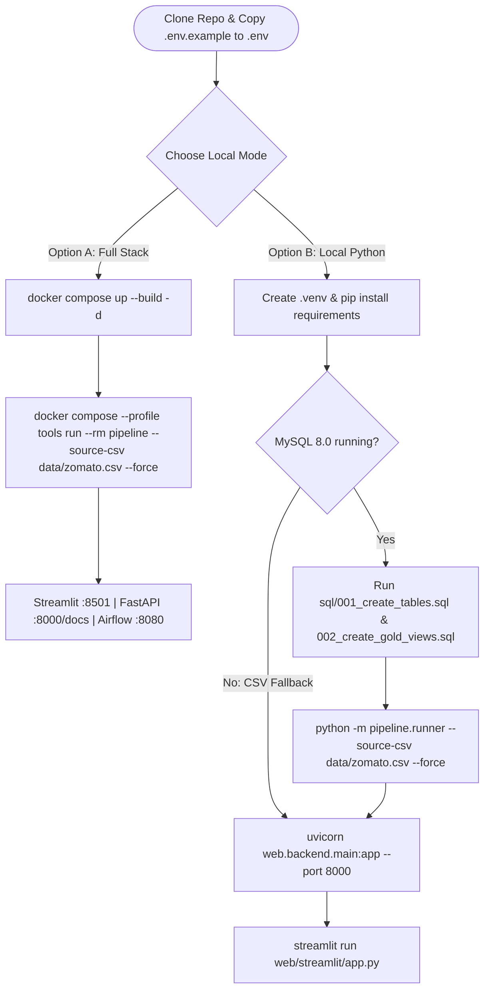

# Running Locally (Docker Compose & Local Python)

> **Last updated:** 2026-11-26  
> **Scope:** Local development, testing, and full-stack Docker Compose execution. For cloud deployment, see [`docs/DEPLOY_AZURE.md`](DEPLOY_AZURE.md).

## 1. Local Execution Workflows

Choose **Option A (Docker Compose)** for the full containerized stack (MySQL 8.0, Apache Airflow 3.x, FastAPI + ONNX, Streamlit) or **Option B (Local Python)** for fast code iteration and testing without Docker.



---

## 2. Option A: Docker Compose (Full Stack)

Runs **MySQL 8.0**, **Apache Airflow 3.x** (backed by PostgreSQL), **FastAPI** (with pre-baked `all-MiniLM-L6-v2` ONNX weights), and **Streamlit 1.67.x** together.

### 2.1 Prerequisites

- Docker Desktop (running) with Docker Compose v2
- Copy [`.env.example`](../.env.example) to `.env` and fill in:
  - `MYSQL_ROOT_PASSWORD`, `MYSQL_APP_USER` / `MYSQL_APP_PASSWORD`, `MYSQL_PIPELINE_USER` / `MYSQL_PIPELINE_PASSWORD`
  - `AIRFLOW_PG_PASSWORD`, `AIRFLOW_FERNET_KEY`, `AIRFLOW_JWT_SECRET`
  - `KAGGLE_USERNAME`, `KAGGLE_KEY`, `HF_API_KEY`

### 2.2 Start Services & Seed Data

```bash
# 1. Build and start MySQL, Airflow, FastAPI, and Streamlit
docker compose up --build -d

# 2. Run the Medallion ETL pipeline into containerized MySQL
docker compose --profile tools run --rm pipeline --source-csv data/zomato.csv --force
```

### 2.3 Local Service Endpoints

| Service | URL | Notes |
| --- | --- | --- |
| **Streamlit Web App** | `http://127.0.0.1:8501` | Connects strictly to FastAPI over HTTP (`STREAMLIT_BACKEND_URL`) |
| **FastAPI Backend & OpenAPI** | `http://127.0.0.1:8000/docs` | Health probe at `http://127.0.0.1:8000/api/health` |
| **Apache Airflow 3.x UI** | `http://127.0.0.1:8080` | Runs `zomato_weekly_etl` DAG using `AIRFLOW_CONN_*` env vars |

### 2.4 Stop or Reset

```bash
docker compose down        # Stop containers; keep MySQL & Airflow volumes
docker compose down -v     # Stop containers and wipe volumes for a clean re-init
```

---

## 3. Option B: Local Python Development (Without Docker)

Ideal for rapid backend/UI/pipeline development. When `APP_ENV=local` and `BACKEND_ALLOW_CSV_FALLBACK_IN_LOCAL=true`, the FastAPI backend automatically falls back to `data/zomato.csv` if local MySQL is offline.

### 3.1 Install Dependencies

```powershell
python -m venv .venv
# Windows PowerShell:
.\.venv\Scripts\python.exe -m pip install -r pipeline/requirements.txt -r web/backend/requirements.txt -r web/streamlit/requirements.txt
# Linux / macOS:
./.venv/bin/python -m pip install -r pipeline/requirements.txt -r web/backend/requirements.txt -r web/streamlit/requirements.txt
```

### 3.2 Configure Environment & Optional MySQL

1. Copy [`.env.example`](../.env.example) to `.env` (keep `APP_ENV=local` and `MYSQL_TLS_ENABLED=FALSE` for local MySQL).
2. *(Optional)* If using a local MySQL 8.0 instance, execute the SQL scripts in order:
   1. [`sql/000_reset.sql`](../sql/000_reset.sql) *(dev/demo reset only)*
   2. [`sql/001_create_tables.sql`](../sql/001_create_tables.sql)
   3. [`sql/002_create_gold_views.sql`](../sql/002_create_gold_views.sql)

### 3.3 Run Pipeline, Backend, and Streamlit

```powershell
# 1. Pipeline dry-run (validates Bronze/Silver/quality rules without DB writes)
.\.venv\Scripts\python.exe -m pipeline.runner --source-csv data/zomato.csv --dry-run

# 2. Start FastAPI backend (Terminal 1)
.\.venv\Scripts\python.exe -m uvicorn web.backend.main:app --host 127.0.0.1 --port 8000

# 3. Start Streamlit UI (Terminal 2)
.\.venv\Scripts\python.exe -m streamlit run web/streamlit/app.py
```

### 3.4 Quality Gates & Test Suite

```powershell
.\.venv\Scripts\python.exe -m ruff check pipeline web tests
.\.venv\Scripts\python.exe -m ruff format --check pipeline web tests
.\.venv\Scripts\python.exe -m mypy .
.\.venv\Scripts\python.exe -m pytest -v
```

---

## 4. Common Local Errors & Fixes

| Symptom / Error | Cause | Fix |
| --- | --- | --- |
| `open //./pipe/dockerDesktopLinuxEngine: The system cannot find the file specified` | Docker Desktop daemon is not running on Windows | Start Docker Desktop and wait until the engine status is green |
| `ModuleNotFoundError: No module named 'six'` when running Kaggle fetch | `kaggle` 1.x requires `six` at runtime | Already pinned in [`pipeline/requirements.txt`](../pipeline/requirements.txt); re-run `pip install -r pipeline/requirements.txt` or rebuild container |
| `Backend returning data_mode: "csv_fallback"` when local MySQL is intended | Local MySQL is stopped, port `3306` differs, or `MYSQL_APP_USER` credentials in `.env` don't match | Start MySQL, verify `MYSQL_HOST`/`MYSQL_PORT`, or run `docker compose up -d mysql` |
| `Airflow DAG container permission denied on ./data or ./logs` | Host bind-mount ownership mismatch on Linux/WSL2 | Set `AIRFLOW_UID=50000` (or `id -u`) in `.env` |
| `ValueError: MYSQL_APP_PASSWORD must not be empty or a placeholder in production` | `APP_ENV=production` is set locally with `.env` placeholders | Keep `APP_ENV=local` in `.env` for local development |
