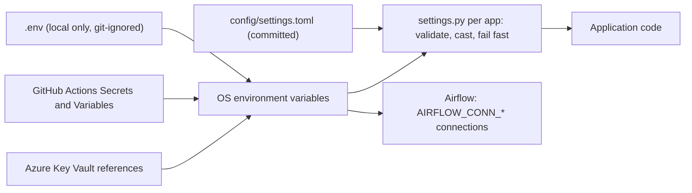

# Secrets and Configuration

> **Status:** Draft v0.2, a living document.
> **Last updated:** 2026-11-24

This document is the single reference for how the project stores, loads, and changes **secrets** and **non-secret configuration** in every component (pipeline, Airflow, FastAPI backend, Streamlit) and every environment (local, CI, production).

## 1. Principle: one home per kind of value

Every value the system reads has exactly one home, decided by its kind:

| Kind | Examples | Home | Committed? |
| --- | --- | --- | --- |
| **Secret** | Database passwords, API keys, Fernet key, connection strings | Environment variables. Locally from `.env`; in CI from GitHub Actions Secrets; in production from Azure Key Vault references | Never. Only the names are listed in `.env.example` |
| **Environment-specific setting** | Database host, backend URL, CORS origins, storage backend (`local` or `azure`) | Environment variables, same channels as secrets | Names and safe local examples in `.env.example` |
| **Tunable setting (non-secret)** | Timeouts, limits, thresholds, schedules, dataset identifiers, file paths, log caps | `config/settings.toml` | Yes, with real values |

Rules:

- A secret never appears in `config/settings.toml`, in code, in a DAG file, in a log line, or in `st.secrets`.
- A tunable setting never appears as an inline literal in business logic. Portable cross-app tunables live in `config/settings.toml` and are read through each app's `settings.py`; code-level constants (rule names, schema bounds, and named constant defaults such as `NLP_TIMEOUT_SECONDS = 5`, `QUERY_LOG_MAX_CHARS = 220`, and `MAX_QUARANTINE_RATE = 0.15`) are exposed in dedicated `constants.py` modules per package (`pipeline/constants.py`, `web/backend/constants.py`, `web/streamlit/constants.py`) for readability and maintainability across the codebase.



## 2. `.env.example`: the catalogue of environment variables

`.env.example` at the repository root lists every environment variable the project reads, grouped by component, with a comment and a placeholder (`replace_with_...`). It never contains a real secret.

- A pull request that adds or removes an environment variable updates `.env.example` in the same pull request.
- Local setup: `cp .env.example .env`, then fill in real values. `.env` is git-ignored.

## 3. `config/settings.toml`: the single source of non-secret settings

One committed TOML file holds every tunable, non-secret value, grouped in sections. Each app reads only the sections it needs. Because the file is read (not imported), sharing it does not break the import boundaries in `CODE_STYLE.md`.

**Reference content** (values are the agreed defaults; dataset identifiers marked "confirm" are open in `DATA_SOURCES.md`):

```toml
[logging]
level = "INFO"
format = "json"              # structured JSON logs (ARCHITECTURE.md, section 12)
query_max_chars = 220        # user NLP text is truncated to this length in logs

[quality]
max_quarantine_rate = 0.15   # quality gate (DATA_QUALITY_RULES.md, section 2)
rating_min = 0.0
rating_max = 5.0
price_range_min = 1
price_range_max = 4
latitude_abs_max = 90.0
longitude_abs_max = 180.0

[freshness]
gold_max_age_days = 7        # older data shows a staleness notice in the app

[pipeline]
bronze_local_path = "data/bronze"
quarantine_path = "data/quarantine"
reports_path = "data/reports"
logs_path = "logs"
bronze_container = "bronze"

[database]
connect_timeout_seconds = 15

[sources.zomato]
kaggle_dataset = "shrutimehta/zomato-restaurants-data"
schedule = "@weekly"
skip_if_unchanged = true
file_name = "zomato.csv"
file_encoding = "latin-1"                                 # confirm (DATA_SOURCES.md, DS-2)

[nlp]
model_id = "Qwen/Qwen3-32B"
provider = "auto"
semantic_model_id = "sentence-transformers/all-MiniLM-L6-v2"
semantic_enabled = true
semantic_cuisine_threshold = 0.48
semantic_price_threshold = 0.44
timeout_seconds = 5
max_input_chars = 500
max_output_tokens = 256
temperature = 0
cache_max_entries = 1000
cache_ttl_seconds = 3600

[backend]
nlp_rate_limit_per_minute = 30
page_default_limit = 20
page_max_limit = 100
allow_csv_fallback_in_local = true
local_fallback_csv_path = "data/zomato.csv"

[streamlit]
api_timeout_seconds = 10
cache_ttl_seconds = 300
```

**Naming and overrides.** A key `[section] key` becomes the settings field `section_key` and can be overridden by the environment variable `SECTION_KEY` (for example `[nlp] timeout_seconds` is overridden by `NLP_TIMEOUT_SECONDS`; `[sources.zomato] schedule` by `SOURCES_ZOMATO_SCHEDULE`). Overrides are for CI and incident handling; the normal way to change a value is a reviewed edit to `config/settings.toml`.

**Deployment.** Each deployed app package includes `config/settings.toml`. The optional environment variable `APP_CONFIG_PATH` points to a different file when needed.

## 4. Settings modules: one per app

Each app has exactly one settings module. No other file reads `os.environ`, `os.getenv`, or `config/settings.toml` directly.

| App | Settings module | Reads |
| --- | --- | --- |
| ETL pipeline | `pipeline/settings.py` | `[logging]`, `[quality]`, `[pipeline]`, `[sources.*]`; MySQL pipeline account, Blob, Kaggle, FX secrets |
| FastAPI backend | `web/backend/settings.py` | `[logging]`, `[freshness]`, `[nlp]`, `[backend]`; MySQL app account, Hugging Face key, CORS origins |
| Streamlit app | `web/streamlit/settings.py` | `[logging]`, `[freshness]`, `[streamlit]`; backend URL only. No database values |
| Airflow DAGs | Use `pipeline/settings.py` for schedules; connections come from `AIRFLOW_CONN_*` (section 7) | |

Implementation pattern (finalized during refactoring): a `pydantic-settings` `BaseSettings` class per app, with the TOML sections flattened into fields and environment variables taking precedence. Secrets are typed as `SecretStr` and have **no default**, so a missing secret raises a validation error at startup instead of failing later inside a request or task. The module exposes one module-level `settings` object.

## 5. Precedence (highest first)

1. OS environment variables (Azure Container Apps / Job environment & Key Vault references, CI `env:`, Docker `environment:`).
2. `.env` file (local development only).
3. `config/settings.toml`.
4. Defaults in the settings class (non-secret only).

## 6. Environments

| Environment | Secrets and environment-specific values | Tunable settings |
| --- | --- | --- |
| Local | `.env` | `config/settings.toml` |
| CI / CD (GitHub Actions) | **Passwordless OIDC** (`id-token: write`): only 3 non-password identifiers in Repository **Secrets** (`AZURE_CLIENT_ID`, `AZURE_TENANT_ID`, `AZURE_SUBSCRIPTION_ID`) plus optional Repository **Variables** (`ACR_NAME`, `AZURE_RESOURCE_GROUP`) for forks. Runtime DB/API secrets are never stored in GitHub | `config/settings.toml` (plus `SECTION_KEY` overrides if a test needs them) |
| Production: Azure Container Apps (`ca-eatosphere-backend`, `ca-eatosphere-streamlit`) | Container env vars; backend secrets via Key Vault references (`keyvaultref:...` with Managed Identity `id-eatosphere-prod`); Streamlit holds zero DB credentials | `config/settings.toml` baked into container image |
| Production: ACA Scheduled Job (`job-eatosphere-etl`) | Key Vault values (`keyvaultref:...`) injected as environment variables into the `@weekly` ETL job | `config/settings.toml` baked into container image |
| Local Docker: Airflow 3.x | `AIRFLOW_CONN_*` JSON connection strings composed from `.env` in `docker-compose.yml` | `config/settings.toml` mounted/baked with DAGs |

## 7. Airflow credentials (decision R5-B)

**Decision:** Airflow connections are supplied as Docker-injected `AIRFLOW_CONN_*` environment variables, loaded from `.env` locally and from Azure Key Vault environment references in production. This lets DAGs use Airflow's native hooks and sensors (`MySqlHook`, `WasbHook`, `WasbBlobSensor`) with no connection rows in the Airflow metadata database, no per-task Key Vault calls, and no extra local infrastructure cost.

| Connection ID | Environment variable | Used for |
| --- | --- | --- |
| `mysql_pipeline` | `AIRFLOW_CONN_MYSQL_PIPELINE` | Pipeline writes to Silver and Gold (pipeline account, not the app account) |
| `azure_blob_bronze` | `AIRFLOW_CONN_AZURE_BLOB_BRONZE` | Bronze reads and writes; blob sensors |

**One source of the values.** `.env` holds the component values once (`MYSQL_HOST`, `MYSQL_PIPELINE_USER`, `MYSQL_PIPELINE_PASSWORD`, and so on). `docker-compose.yml` composes the `AIRFLOW_CONN_*` variables from them through variable interpolation, so a password is never written twice. Airflow accepts the JSON connection format, which avoids URL-encoding problems with special characters in passwords:

```yaml
# docker-compose.yml (excerpt, illustrative)
environment:
  AIRFLOW_CONN_MYSQL_PIPELINE: >-
    {"conn_type": "mysql", "host": "${MYSQL_HOST}", "port": ${MYSQL_PORT},
     "schema": "${MYSQL_DATABASE}", "login": "${MYSQL_PIPELINE_USER}",
     "password": "${MYSQL_PIPELINE_PASSWORD}"}
```

**Other Airflow secrets.** `AIRFLOW_FERNET_KEY`, `AIRFLOW_JWT_SECRET`, and `AIRFLOW_PG_PASSWORD` are environment variables from the same channels.

**Boundaries.** DAG files reference connections by ID only and contain no credentials. `pipeline/` never imports Airflow: a DAG task resolves the connection with a hook inside the task and passes connection details or an open connection into the pipeline function. Credentials are never passed through XCom. When the pipeline runs outside Airflow (local scripts, tests), `pipeline/settings.py` builds the same connection from the `MYSQL_PIPELINE_*` variables.

> [!NOTE]
> `MySqlHook` uses its own MySQL client library, not PyMySQL. Pipeline modules keep using PyMySQL (`CODE_STYLE.md`, section 4); where a DAG passes a hook connection into pipeline code, the team checks placeholder style and TLS settings during refactoring.

**Airflow Variables** are not used for configuration; tunable values come from `config/settings.toml` so there is one source of truth.

## 8. Secrets and logs

- Never log a secret, a connection string, or a full connection object.
- User NLP text is logged only truncated to `[logging] query_max_chars` (220 characters).
- Settings objects use `SecretStr` so secrets are masked when printed.

## 9. Rotation

| Event | Action |
| --- | --- |
| Secret committed by mistake | Tell the team immediately and rotate it. Deleting the commit is not enough |
| Planned production rotation | Update the Key Vault secret, then restart the Container App revision or job. No code change |
| Airflow Fernet key rotation | Follow Airflow's key-rotation procedure (old and new keys side by side, then remove the old key) |
| Team member leaves | Rotate shared secrets (database passwords, Fernet key, JWT secret, API keys) |

## 10. Enforcement checklist (pull requests)

- [ ] No `os.environ`, `os.getenv`, or direct reads of `config/settings.toml` outside the app's `settings.py`.
- [ ] New environment variables are added to `.env.example`; new tunable values are added to `config/settings.toml`.
- [ ] No real secret in `.env.example`, `config/settings.toml`, code, DAGs, or tests.
- [ ] No hardcoded timeout, limit, threshold, or path in code.
- [ ] DAGs use connection IDs only.
- [ ] Secret scanning (`gitleaks` or equivalent) passes.

## 11. Change log

| Date | Change |
| --- | --- |
| 2026-11-23 | v0.1 created: environment variables as the injection point, `pydantic-settings` per app, Key Vault references |
| 2026-11-24 | v0.2: split values by kind (secret, environment-specific, tunable); added committed `config/settings.toml` as the single source of non-secret settings and constants; adopted Docker-injected `AIRFLOW_CONN_*` connections (R5-B) composed from `.env`; dropped Airflow Variables for configuration; log truncation set to 220 characters; Kaggle credentials added |
