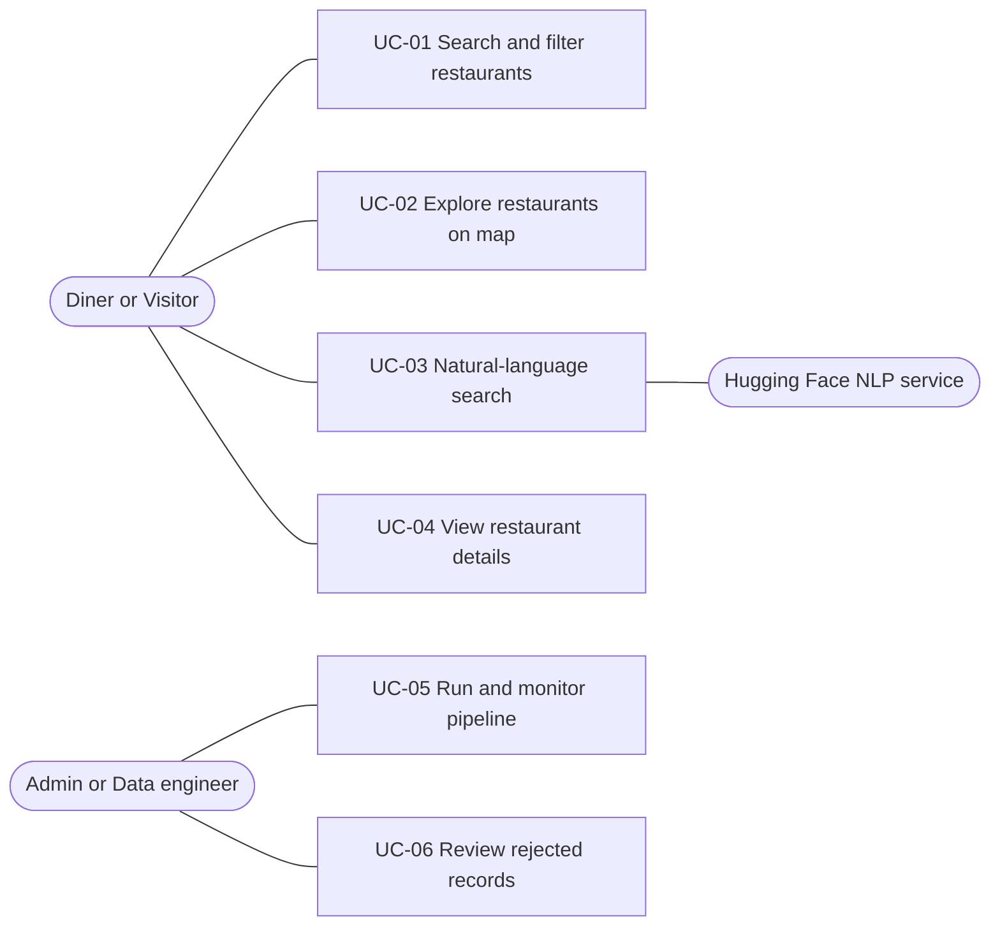

# Software Requirements Specification (SRS)

> **Status:** Draft v0.5, a living document. Requirements may be added, changed, or dropped as spikes conclude and the team learns more. Priorities use MoSCoW (Must / Should / Could).
> **Last updated:** 2026-11-26

## 1. Introduction

### 1.1 Purpose

Describes what the system must do and the qualities it must have, so the team, instructor, and future contributors share one understanding.

### 1.2 Problem statement

Restaurant information is spread across datasets with inconsistent formats, missing values, duplicate records, and different geographic representations. This makes it hard to search, compare, and explore restaurants across locations. The project builds an integrated data platform that standardizes this information and exposes it through a web application.

### 1.3 Objectives

1. Integrate restaurant data into one centralized MySQL database on Azure through a multi-source-capable schema, starting with the Zomato baseline dataset in Increment 1 and extending to additional sources in subsequent increments.
2. Build automated, scheduled Bronze, Silver, and Gold pipelines with dynamic source fetching, change detection, incremental loads, and data-quality gates.
3. Provide filtering, an interactive map, and natural-language search.
4. Orchestrate the pipeline with Apache Airflow and deploy on Microsoft Azure.
5. Document the system, including requirements, architecture, data quality rules, secrets management, and UI/UX guidelines, following market and software engineering best practices.
6. As students, learn and demonstrate skills obtained in data engineering, software engineering, web development, and cloud deployment.

### 1.4 Scope

In scope: pipeline, database, API, web app (filters, map, NLP search), deployment, documentation. To satisfy Agile delivery of a working software increment, **Increment 1** delivers the full end-to-end platform on the Zomato dataset (fetched dynamically via the Kaggle API); multi-source ingestion, schema mapping contracts, and entity resolution rules follow in Increment 2. Out of scope: see section 9.

### 1.5 Definitions

- **Bronze / Silver / Gold:** raw, cleaned, and consumption-ready data layers.
- **Quarantine:** a table (`data_quality_issues`) holding invalid or warned records and the reason they were flagged (`docs/DATA_QUALITY_RULES.md`).
- **Quality gate:** an automated pipeline guard that aborts Silver/Gold promotion if the batch rejection rate exceeds 15%.
- **Entity resolution:** deciding which records from different sources describe the same restaurant (`match_group_id` placeholder in Increment 1).
- **Spike:** a timeboxed investigation to settle an open question.

## 2. Stakeholders

| Stakeholder | Interest | Influence |
| ------------- | ---------- | ----------- |
| Diner / local resident | Find suitable restaurants quickly | High (primary user) |
| Foreign visitor / expat | Discover local options in an unfamiliar city | High |
| Data engineer / admin (the team) | Reliable, observable pipeline | High |
| Instructor / academy | Meets learning and documentation criteria | High |
| Restaurant owner | Accurate listing | Low (future work) |
| Business analyst / investor | Competition and coverage insight | Low (future work) |
| Data and API providers | License and terms compliance | Constraint |

## 3. User stories

| ID | As a... | I want to... | So that... | Priority |
| ---- | --------- | -------------- | ----------- | ---------- |
| US-01 | Diner | filter by country, city, and locality | I see only relevant places | Must |
| US-02 | Diner | filter by cuisine | I find the food I want | Must |
| US-03 | Diner | filter by price and minimum rating | I match budget and quality | Must |
| US-04 | Diner | see results on a map and click a marker for details | I understand where places are | Must |
| US-05 | Visitor | type a request in plain language | I don't need to learn filters | Must |
| US-06 | Visitor | see how my request was interpreted, and get a clarifying question if it is unclear | I can correct misunderstandings | Should |
| US-07 | Diner | search by restaurant name | I find a place I already know | Should |
| US-08 | Diner | filter by delivery or table booking | I find places that suit how I want to eat | Could |
| US-09 | Any user | see the data source and freshness of each restaurant | I can judge how much to trust it | Should |
| US-10 | Admin | run the pipeline on a schedule without manual downloads or duplicate records | data stays fresh and consistent | Must |
| US-11 | Admin | see rejected records, reasons, and quality-gate failures | I can trust and fix the data | Must |
| US-12 | Admin | see the latest pipeline run, freshness, and per-rule quality statistics | I can monitor data health | Should |
| US-13 | Visitor | use the app in Arabic | I can search in my language | Could |

## 4. Use cases

### 4.1 Actors and overview

*(A simplified approximation. A formal UML use case diagram may be drawn in draw.io and stored in `docs/diagrams/`.)*

### 4.2 UC-03: Natural-language search (detailed)

| Item | Description |
| ------ | ------------- |
| Actor | Diner or Visitor; Hugging Face service (supporting) |
| Preconditions | Database loaded; NLP adapter configured |
| Trigger | User submits a free-text request |
| Main flow | 1. Streamlit sends the text to the backend. 2. Backend sends it to the NLP adapter (5-second timeout). 3. Adapter returns structured parameters (country, city, cuisine, price, rating, locality). 4. Backend validates the parameters against the schema and known canonical vocabulary (`docs/CUISINE_VOCABULARY.md`). 5. Backend runs a parameterized query. 6. Streamlit shows results, map markers, and the interpreted filters. |
| Alternate flows | A1. Remote LLM service fails, lacks credits, or times out: fall back to the local Hugging Face `all-MiniLM-L6-v2` ONNX semantic hybrid + deterministic rules. A2. Output invalid: discard and use local fallback. A3. Request off-topic, ambiguous, or in an unsupported area: ask the user to clarify (`needs_clarification`). A4. Follow-up prompt refines prior `previous_params` statelessly until reset. A5. No results: suggest relaxing filters. |
| Postconditions | Results shown; interpreted filters visible |
| Notes | The model never produces executable SQL. Parameters are its only output. User query logs are truncated to 220 characters. |

### 4.3 Other use cases

- **UC-01 Search and filter:** user selects filters; system returns paginated, sortable results.
- **UC-02 Explore on map:** user pans and zooms; markers cluster; selecting a marker shows details; paired with a tabular view (`docs/UI_UX.md`).
- **UC-04 View details:** name, canonical cuisines, locality, original cost and currency (plus batch-standardized USD value where cross-country comparison applies), rating (explicit `Unrated` when `NULL`), source, and license.
- **UC-05 Run and monitor pipeline:** Airflow triggers a source check on its schedule (or admin triggers manually); unchanged sources skip cleanly; runs exceeding the 15% quarantine gate fail loudly and alert.
- **UC-06 Review rejected records:** admin inspects quarantined records, rule breakdown, and reasons.

## 5. Functional requirements

| ID | Requirement | Priority | Story |
| ---- | ------------- | ---------- | ------- |
| **Search and filtering** | | | |
| FR-S1 | Filter by country and city | Must | US-01 |
| FR-S2 | Filter by locality | Should | US-01 |
| FR-S3 | Filter by one or more canonical cuisines (`docs/CUISINE_VOCABULARY.md`) | Must | US-02 |
| FR-S4 | Filter by minimum and maximum cost for two (preserving original local currency for display, and using batch-pinned `avg_cost_for_two_usd` when filtering or sorting across countries) and by price range tier (1–4) | Must | US-03 |
| FR-S5 | Filter by minimum rating; unrated places (`NULL`) are handled explicitly and never shown as `0` | Must | US-03 |
| FR-S6 | Filter by delivery and booking flags | Could | US-08 |
| FR-S7 | Search by name (typo-tolerant if time allows) | Should | US-07 |
| FR-S8 | Sort and paginate results | Must | US-01 |
| FR-S9 | Show restaurant details including data source and license | Should | US-09 |
| **Map** | | | |
| FR-M1 | Show results as markers with details on selection, paired with a tabular equivalent | Must | US-04 |
| FR-M2 | Cluster markers at low zoom | Should | US-04 |
| FR-M3 | Selecting a marker or list item highlights the other | Should | US-04 |
| FR-M4 | Explore restaurants near a selected location (bounding box + spherical distance) | Could | US-04 |
| **NLP search** | | | |
| FR-N1 | Accept free-text requests in English (input length capped at API boundary) | Must | US-05 |
| FR-N2 | Translate requests into validated structured parameters checked against known locations and canonical cuisines | Must | US-05 |
| FR-N3 | Show interpreted filters to the user | Should | US-06 |
| FR-N4 | Ask for clarification when a request is ambiguous or unsupported | Should | US-06 |
| FR-N5 | Fall back to the local Hugging Face ONNX semantic hybrid + deterministic rule-based parser if the remote service fails, exceeds the 5-second timeout, or returns invalid output | Must | US-05 |
| FR-N6 | Never execute model-generated SQL; use parameterized queries only | Must | US-05 |
| FR-N7 | Accept Arabic requests | Could | US-13 |
| **Data pipeline** | | | |
| FR-D1 | Dynamically fetch the Zomato dataset by code via the Kaggle API in Increment 1, with schema and provenance support for integrating at least one additional source in Increment 2 (`docs/DATA_SOURCES.md`) | Must | US-10 |
| FR-D2 | Check source version/update metadata and SHA-256 checksum before loading; store changed files append-only in Azure Blob Storage (Bronze) keyed by source, ingestion date, and batch ID | Must | US-10 |
| FR-D3 | Clean and standardize country, city, canonical cuisine, and batch-pinned USD cost; validate ratings, prices, and coordinates (`docs/DATA_QUALITY_RULES.md`); load Silver tables | Must | US-02 |
| FR-D4 | Send invalid records to `data_quality_issues` with `rule_name`, `severity`, and `reason`; enforce a **15% maximum quarantine rate** safety guard before promoting to Silver/Gold | Must | US-11 |
| FR-D5 | Build Gold tables, views, and spatial/composite indexes for search and map | Must | US-01 |
| FR-D6 | Re-runs do not duplicate data (idempotent upserts on `(source_id, source_restaurant_id)`) | Must | US-10 |
| FR-D7 | Incremental processing: skip unchanged upstream snapshots (`skipped_unchanged`) and update only new or changed records via `record_hash` | Must | US-10 |
| FR-D8 | Detect likely duplicates across sources (`match_group_id` placeholder in Increment 1; matching rules in Increment 2) | Should | US-09 |
| FR-D9 | Orchestrate the pipeline with per-source scheduled Airflow DAGs (`@weekly` change-checked for Zomato) with retries, backoff, and alerts | Must | US-10 |
| FR-D10 | Record pipeline runs (`rows_read`, `rows_inserted`, `rows_updated`, `rows_unchanged`, `rows_quarantined`, `rows_warned`, `quarantine_rate`) and ingestion batches | Should | US-12 |
| **Administration & Operations** | | | |
| FR-A1 | Expose latest run status, data freshness, and per-rule quality breakdown via `GET /api/pipeline/status` | Should | US-12 |
| FR-A2 | Expose `GET /api/health` returning `{"status": "ok"}` for deployment health checks | Must | US-10 |

## 6. Non-functional requirements

Targets are initial baselines validated during implementation and evaluation.

| Category | Requirement |
| ---------- | ------------- |
| Performance & capacity | Typical filtered search returns in under 2 seconds at the MVP volume (~10,000 restaurants) and up to the design ceiling of **100,000 restaurants**, supporting **5–20 concurrent users** during demos and evaluation. Hugging Face calls enforce a **5-second** timeout (`NLP_TIMEOUT_SECONDS = 5`). |
| Reliability & freshness | Initial availability goal of **95%** for the FastAPI and Streamlit tiers. Failed pipeline tasks retry with exponential backoff and fail loudly; re-runs are idempotent. Gold data older than **7 days** without a successful run (including `skipped_unchanged`) triggers a staleness warning. Showing a maintenance screen when the backend is unreachable is a low-priority (Could) enhancement. |
| Data quality | Rules catalogued in `docs/DATA_QUALITY_RULES.md`; coordinates, ratings, and costs validated; invalid records quarantined; runs exceeding a **15% quarantine rate** abort Silver/Gold promotion (`quality_gate_failed`). |
| Security & configuration | Streamlit holds no database credentials and calls FastAPI exclusively over HTTP/HTTPS via `web/streamlit/api_client.py`; backend uses a read-only DB user and parameterized queries; pipeline uses a separate write account; all secrets arrive via OS environment variables (`.env` locally, GitHub Actions Secrets in CI, Azure Key Vault references in prod) and Airflow uses Docker-injected `AIRFLOW_CONN_*` variables (`docs/SECRETS.md`); non-secret settings live in `config/settings.toml` and shared code constants in `constants.py`; HTTPS everywhere; DB firewall restricted. |
| Privacy | No personal data collected; user text sent to the NLP provider is treated as non-sensitive (disclosed in UI) and truncated to **220 characters** in logs. |
| Compatibility | Python 3.12+, MySQL 8.0, Streamlit 1.67.x, Airflow 3.x. Supported evergreen browsers: **Chrome, Edge, and Firefox**. API uses no version prefix; FastAPI and Streamlit deploy together from the same commit, migrating callers in place on schema changes. |
| Legal and licensing | Source licenses and attribution kept per record; no data or API used against provider terms. License-based view routing deferred until a share-alike source is integrated. |
| Usability & accessibility | Editorial / Paper & Ink dual-theme UI (`docs/UI_UX.md`); responsive from ~375 px phone width to desktop; clear loading, empty, and error states; explicit labels on all inputs, tabular equivalents for maps/charts, and readable contrast. |
| Maintainability | Modular 3-tier code, `docs/CODE_STYLE.md`, Ruff, mypy, import boundary enforcement (`tests/test_architecture.py`), and shared constants modules. |
| Portability | Cross-platform `pathlib.Path`; `.env.example` catalogues all environment variables; `config/settings.toml` centralizes non-secret settings; local Docker setup and `README.md` run guide finalized post-refactoring. |
| Cost | Fits available Azure credits; zero-extra-cost `AIRFLOW_CONN_*` injection; budget alert configured. |
| Observability | JSON structured logging (`timestamp`, `level`, `logger`, `message`, `run_id`, `batch_id`, `source_id`, `rule_name`); `GET /api/health` liveness check; alerts on >15% quarantine rate, task failure after retries, and >7-day data staleness. |

## 7. Constraints and assumptions

- Team of 6 students; build window about 15–30 Nov, 2026.
- Technology baseline: Python 3.12+, MySQL 8.0 on Azure, Airflow 3.x, FastAPI, Streamlit 1.67.x, Hugging Face.
- Data must come from open or permitted sources and be fetched programmatically (no manual file drops).
- Increment 1 uses the Zomato dataset, which is concentrated in India; coverage is stated honestly in the UI.
- Prices in multi-country datasets use local currencies; original amounts and ISO 4217 codes are preserved, while batch-pinned USD amounts (`avg_cost_for_two_usd`) support cross-country filtering and sorting.

## 8. Open issues

| ID | Question | Resolution path |
| ---- | ---------- | ----------------- |
| OI-1 | Which additional source(s) for Increment 2 | Spike S1 (`docs/DATA_SOURCES.md`) |
| OI-2 | Airflow / ETL hosting (local Docker vs. Azure) | **Closed (Spike S2 / D-2):** Azure Container Apps Scheduled Job (`@weekly`) in prod; Apache Airflow 3.x in local Docker Compose |
| OI-3 | Hugging Face model and provider | **Closed (Spike S3):** `all-MiniLM-L6-v2` ONNX semantic hybrid + `InferenceClient` tier |
| OI-4 | Azure access, credits, cost | **Closed (Spike S4):** Deployed in `polandcentral` on Azure for Students (`~$5–$21/month`) |
| OI-5 | Target countries and cities for the demo | Zomato cities in Increment 1; revisit with Source 2 |
| OI-6 | Handling mixed currencies | **Closed:** keep original amount + ISO 4217 code and compute batch-pinned `avg_cost_for_two_usd` (`CODE_STYLE.md` §2) |
| OI-7 | Final deadline date | Confirm with the academy |

## 9. Out of scope / future work

Owner accounts and verification, B2B matching, in-app reviews, gap or saturation analytics, additional business types (cafes, pharmacies, gyms), coordinate/locality imputation, and cross-source record attribute enrichment (deferred low priority, D-8).

## 10. Traceability

Each requirement links to a user story. Automated architecture boundary tests (`tests/test_architecture.py`), quality-rule unit tests, and Streamlit smoke tests (`AppTest`) accompany implementation; comprehensive test-plan traceability (`docs/TESTING.md`), coverage gates, and schema contract tests are deferred until full refactoring completes.

## 11. Change log

| Date | Change |
| --- | --- |
| 2026-10-30 | v0.1 created |
| 2026-10-30 | v0.2: aligned to team proposal; added admin stories, currency and Egypt coverage notes |
| 2026-11-23 | v0.3: codified Option A data access (Streamlit calls FastAPI over HTTP via `api_client.py`, holding no database credentials); updated testing scope to include Streamlit `AppTest` smoke tests |
| 2026-11-24 | v0.4: scoped Increment 1 to Zomato via dynamic Kaggle API fetch; promoted FR-D7 (incremental loads & change detection) to Must; promoted US-12 and FR-A1 (`/api/pipeline/status` with per-rule breakdown) to Should; added FR-A2 (`GET /api/health`); added 15% quarantine gate, 7-day staleness threshold, 95% availability goal, 100K restaurant / 5–20 user capacity targets, 5s HF timeout, 220-char query log cap, JSON structured logging, Chrome/Edge/Firefox browser support, co-deployed unversioned API policy, `AIRFLOW_CONN_*` & `config/settings.toml` rules, and `UI_UX.md` / `CUISINE_VOCABULARY.md` / `DATA_QUALITY_RULES.md` references; closed OI-6 |
| 2026-11-26 | v0.5: closed OI-2 (Spike S2 / Decision D-2: ACA Scheduled Job in prod + Airflow 3.x locally) and OI-4 (Spike S4: Azure Container Apps deployment in `polandcentral`) | Increment 1 production deployment |
