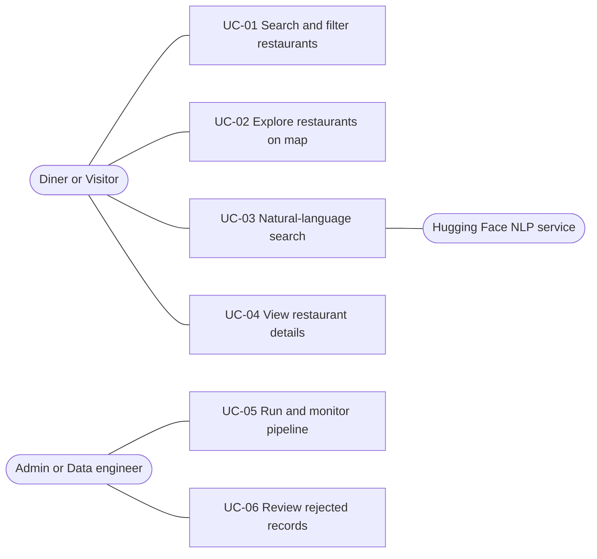

# Software Requirements Specification (SRS)

> **Status:** Draft v0.2, a living document. Requirements may be added, changed, or dropped as spikes conclude and the team learns more. Priorities use MoSCoW (Must / Should / Could).  
> **Last updated:** 2026-10-30

## 1. Introduction

### 1.1 Purpose

Describes what the system must do and the qualities it must have, so the team, instructor, and future contributors share one understanding.

### 1.2 Problem statement

Restaurant information is spread across datasets with inconsistent formats, missing values, duplicate records, and different geographic representations. This makes it hard to search, compare, and explore restaurants across locations. The project builds an integrated data platform that standardizes this information and exposes it through a web application.

### 1.3 Objectives

1. Integrate restaurant data from multiple sources into one centralized MySQL database on Azure.
2. Build automated Bronze, Silver, and Gold pipelines with data-quality checks.
3. Provide filtering, an interactive map, and natural-language search.
4. Orchestrate the pipeline with Apache Airflow and deploy on Microsoft Azure.
5. Document the system, including requirements, architecture, and user guides, following market and software engineering best practices.
6. As students, learn and demonstrate skills obtained in data engineering, web development, and cloud deployment.

### 1.4 Scope

In scope: pipeline, database, API, web app (filters, map, NLP search), deployment, documentation. Out of scope: see section 9.

### 1.5 Definitions

- **Bronze / Silver / Gold:** raw, cleaned, and consumption-ready data layers.
- **Quarantine:** a table holding invalid records and the reason they were rejected.
- **Entity resolution:** deciding which records from different sources describe the same restaurant.
- **Spike:** a timeboxed investigation to settle an open question.

## 2. Stakeholders

| Stakeholder | Interest | Influence |
| ------------- | ---------- | ----------- |
| Diner / local resident | Find suitable restaurants quickly | High (primary user) |
| Foreign visitor / expat | Discover local options in an unfamiliar city | High |
| Data engineer / admin (the team) | Reliable, observable pipeline | High |
| Instructor / academy | Meets learning and documentation criteria | High |
| Restaurant owner | Accurate listing | Low (future work) |
| Business analyst / investor | Competition and coverage insight | Low (future work) |
| Data and API providers | License and terms compliance | Constraint |

## 3. User stories

| ID | As a... | I want to... | So that... | Priority |
| ---- | --------- | -------------- | ----------- | ---------- |
| US-01 | Diner | filter by country, city, and locality | I see only relevant places | Must |
| US-02 | Diner | filter by cuisine | I find the food I want | Must |
| US-03 | Diner | filter by price and minimum rating | I match budget and quality | Must |
| US-04 | Diner | see results on a map and click a marker for details | I understand where places are | Must |
| US-05 | Visitor | type a request in plain language | I don't need to learn filters | Must |
| US-06 | Visitor | see how my request was interpreted, and get a clarifying question if it is unclear | I can correct misunderstandings | Should |
| US-07 | Diner | search by restaurant name | I find a place I already know | Should |
| US-08 | Diner | filter by delivery or table booking | I find places that suit how I want to eat | Could |
| US-09 | Any user | see the data source of each restaurant | I can judge how much to trust it | Should |
| US-10 | Admin | re-run the pipeline without creating duplicates | data stays consistent | Must |
| US-11 | Admin | see rejected records and the reasons | I can trust and fix the data | Must |
| US-12 | Admin | see the latest pipeline run and quality statistics | I can monitor data health | Could |
| US-13 | Visitor | use the app in Arabic | I can search in my language | Could |

## 4. Use cases

### 4.1 Actors and overview

*(A simplified approximation. A formal UML use case diagram will be drawn in draw.io and stored in `docs/diagrams/`.)*

### 4.2 UC-03: Natural-language search (detailed)

| Item | Description |
| ------ | ------------- |
| Actor | Diner or Visitor; Hugging Face service (supporting) |
| Preconditions | Database loaded; NLP adapter configured |
| Trigger | User submits a free-text request |
| Main flow | 1. Frontend sends the text to the backend. 2. Backend sends it to the NLP adapter. 3. Adapter returns structured parameters (country, city, cuisine, price, rating, locality). 4. Backend validates the parameters against the schema and known values. 5. Backend runs a parameterized query. 6. Frontend shows results, map markers, and the interpreted filters. |
| Alternate flows | A1. Service fails or times out: use the rule-based parser. A2. Output invalid: discard and use the rule-based parser. A3. Request ambiguous or unsupported: ask the user to clarify. A4. No results: suggest relaxing filters. |
| Postconditions | Results shown; interpreted filters visible |
| Notes | The model never produces executable SQL. Parameters are its only output. |

### 4.3 Other use cases (to be detailed in Sprint 1)

- **UC-01 Search and filter:** user selects filters; system returns paginated, sortable results.
- **UC-02 Explore on map:** user pans and zooms; markers cluster; selecting a marker shows details.
- **UC-04 View details:** name, cuisines, locality, cost, rating, source.
- **UC-05 Run and monitor pipeline:** admin triggers or inspects a run in Airflow.
- **UC-06 Review rejected records:** admin inspects quarantined records and reasons.

## 5. Functional requirements

| ID | Requirement | Priority | Story |
| ---- | ------------- | ---------- | ------- |
| **Search and filtering** | | | |
| FR-S1 | Filter by country and city | Must | US-01 |
| FR-S2 | Filter by locality | Should | US-01 |
| FR-S3 | Filter by one or more cuisines | Must | US-02 |
| FR-S4 | Filter by minimum and maximum cost for two, compared only within the same currency, and by price range tier | Must | US-03 |
| FR-S5 | Filter by minimum rating; unrated places are handled explicitly | Must | US-03 |
| FR-S6 | Filter by delivery and booking flags | Could | US-08 |
| FR-S7 | Search by name (typo-tolerant if time allows) | Should | US-07 |
| FR-S8 | Sort and paginate results | Must | US-01 |
| FR-S9 | Show restaurant details including data source | Should | US-09 |
| **Map** | | | |
| FR-M1 | Show results as markers with details on selection | Must | US-04 |
| FR-M2 | Cluster markers at low zoom | Should | US-04 |
| FR-M3 | Selecting a marker or list item highlights the other | Should | US-04 |
| FR-M4 | Explore restaurants near a selected location | Could | US-04 |
| **NLP search** | | | |
| FR-N1 | Accept free-text requests in English | Must | US-05 |
| FR-N2 | Translate requests into validated structured parameters | Must | US-05 |
| FR-N3 | Show interpreted filters to the user | Should | US-06 |
| FR-N4 | Ask for clarification when a request is ambiguous or unsupported | Should | US-06 |
| FR-N5 | Fall back to a rule-based parser if the service fails or returns invalid output | Must | US-05 |
| FR-N6 | Never execute model-generated SQL; use parameterized queries only | Must | US-05 |
| FR-N7 | Accept Arabic requests | Could | US-13 |
| **Data pipeline** | | | |
| FR-D1 | Ingest the Zomato dataset and at least one additional source | Must | US-10 |
| FR-D2 | Store original files in Azure Blob Storage (Bronze) with source, ingestion date, and batch ID | Must | US-10 |
| FR-D3 | Clean and standardize country, city, cuisine; validate ratings, prices, coordinates; load Silver tables | Must | US-02 |
| FR-D4 | Send invalid records to a quarantine table with a reason; never drop silently | Must | US-11 |
| FR-D5 | Build Gold tables, views, and indexes for search and map | Must | US-01 |
| FR-D6 | Re-runs do not duplicate data (idempotent loads) | Must | US-10 |
| FR-D7 | Incremental processing of new or changed records | Should | US-10 |
| FR-D8 | Detect likely duplicates across sources | Should | US-09 |
| FR-D9 | Orchestrate the pipeline with an Airflow DAG with retries and logs | Must | US-10 |
| FR-D10 | Record pipeline runs and ingestion batches | Should | US-12 |
| **Administration** | | | |
| FR-A1 | Show latest run status and quality statistics | Could | US-12 |

## 6. Non-functional requirements

Targets are initial and will be validated by measurement.

| Category | Requirement |
| ---------- | ------------- |
| Performance | Typical filtered search returns in under 2 seconds (target); indexes on common filter columns |
| Reliability | Failed pipeline tasks retry and fail loudly; re-runs are safe |
| Data quality | Coordinates validated; invalid records quarantined; quality counts reported per run |
| Security | The frontend never connects to the database; backend uses parameterized queries; credentials in environment variables or Key Vault, never in the repository; HTTPS; database firewall restricted to authorized services |
| Privacy | No personal data collected; user text sent to the NLP provider is treated as non-sensitive and this is disclosed |
| Legal and licensing | Source licenses and attribution kept; no data or API used against provider terms |
| Usability | Responsive layout; clear empty and error states |
| Accessibility | Keyboard navigation and sufficient contrast as a baseline |
| Maintainability | Modular code, `docs/CODE_STYLE.md`, tests for transformation and quality rules |
| Portability | Local setup possible with documented steps or Docker |
| Cost | Fits available Azure credits; budget alert configured |
| Observability | Airflow logs; application errors logged; Azure Monitor if time allows |

## 7. Constraints and assumptions

- Team of 6 students; build window about 15-31 Nov, 2026.
- Technology baseline: Python, MySQL on Azure, Airflow, FastAPI, React, Hugging Face.
- Data must come from open or permitted sources.
- The baseline dataset has limited geographic coverage; the product must state its coverage honestly.
- Prices in the baseline dataset use different currencies and are not directly comparable across countries.

## 8. Open issues

| ID | Question | Resolution path |
| ---- | ---------- | ----------------- |
| OI-1 | Which additional source(s) | Spike S1 |
| OI-2 | Airflow hosting | Spike S2 |
| OI-3 | Hugging Face model and provider | Spike S3 |
| OI-4 | Azure access, credits, cost | Spike S4 |
| OI-5 | Target countries and cities for the demo | Team decision |
| OI-6 | Handling mixed currencies | Sprint 1 design |
| OI-7 | Final deadline date | Confirm with the academy |

## 9. Out of scope / future work

Owner accounts and verification, B2B matching, in-app reviews, gap or saturation analytics, additional business types (cafes, pharmacies, gyms).

## 10. Traceability

Each requirement links to a user story. Each story will link to a test case in `docs/TESTING.md` (could, planned).

## 11. Change log

| Date       | Change       |
|------      | --------     |
| 2026-10-30 | v0.1 created |
| 2026-10-30 | v0.2: aligned to team proposal; added admin stories, currency and Egypt coverage notes        |
