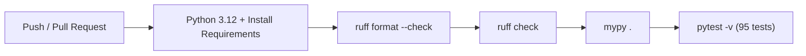

# Testing and Quality Assurance Guide

> **Status:** Active (v1.0) · **Last updated:** 2026-11-26  
> **Scope:** Automated quality gates, test suite inventory, MySQL integration checks, CI workflow, and manual browser E2E verification.

## 1. Automated Quality Gates

Every pull request and push runs four mandatory quality gates (configured in [`pyproject.toml`](../pyproject.toml) and enforced in [`.github/workflows/ci.yml`](../.github/workflows/ci.yml)):

| Gate | Command | Scope & Pass Criteria |
| --- | --- | --- |
| **Formatting** | `ruff format --check pipeline web tests` | 88-char lines, zero formatting drift |
| **Linting** | `ruff check pipeline web tests` | PEP 8, imports, Google docstrings, McCabe <= 18, no `print` (`T20`), timezone-aware UTC (`DTZ`), `pathlib` (`PTH`) |
| **Static Typing** | `mypy .` | Strict typed signatures across `pipeline/`, `web/`, and `tests/` |
| **Test Suite** | `pytest -v` | All 97 unit, architecture boundary, DAG import, API, NLP, spatial, and Streamlit `AppTest` smoke tests pass |

> **Note:** Scope Ruff to `pipeline web tests` rather than `.` so Markdown code snippets in `docs/` are not flagged, and `_incoming/` / `.agents/` remain excluded.

---

## 2. Test Suite Inventory (`tests/`)

| Module | Layer | What It Verifies |
| --- | --- | --- |
| [`tests/test_architecture.py`](../tests/test_architecture.py) | Cross-cutting | 8 AST & hygiene guardrails: import isolation across `pipeline/`, `dags/`, `web/backend/`, `web/streamlit/`; zero raw HTML/components; zero `st.secrets`; single `settings.py` reader; SQL script hygiene |
| [`tests/pipeline/test_quality_rules.py`](../tests/pipeline/test_quality_rules.py) | Pipeline DQ | All batch-level, row-level `reject`, and `warn` rules (`docs/DATA_QUALITY_RULES.md`), duplicate-ID rejection, and 15% quarantine safety gate boundaries |
| [`tests/pipeline/test_cuisine_and_standardize.py`](../tests/pipeline/test_cuisine_and_standardize.py) | Pipeline Transform | Canonical cuisine normalization (`config/cuisine_map.csv`), mojibake repair, `0`/`Not rated` -> `NULL`, ISO-4217 currency + `Decimal` FX USD conversion, deterministic `record_hash` |
| [`tests/pipeline/test_incremental_upsert.py`](../tests/pipeline/test_incremental_upsert.py) | Pipeline Load | Incremental upsert skipping unchanged `record_hash` rows, advancing `last_seen_batch_id`, and Kaggle check-before-download + SHA-256 skip (`skipped_unchanged`) |
| [`tests/pipeline/test_dag_import.py`](../tests/pipeline/test_dag_import.py) | Airflow DAG | Imports `pipeline/dags/zomato_weekly_etl.py` with zero parse-time side effects and verifies task wiring |
| [`tests/backend/test_api_routes.py`](../tests/backend/test_api_routes.py) | FastAPI | `/api/health`, `/api/restaurants`, detail, `/api/map/points`, `/api/search/nl`, `/api/meta/*`, `/api/pipeline/status`, 503 fail-closed in `ci`, parameterized SQL, and 60s local MySQL fallback cooldown |
| [`tests/backend/test_nlp_adapter.py`](../tests/backend/test_nlp_adapter.py) | NLP | `SearchParams` `extra="forbid"`, `RuleBasedParser`, `HuggingFaceAdapter`, `all-MiniLM-L6-v2` ONNX semantic hybrid, vocabulary validation, off-topic guardrails, stateless multi-turn follow-up refinement, and 220-char query log truncation |
| [`tests/backend/test_spatial.py`](../tests/backend/test_spatial.py) | Geospatial | `bounding_box_wkt()` latitude-first closed SRID 4326 polygon, coordinate bounds validation, and Haversine distance |
| [`tests/test_streamlit_smoke.py`](../tests/test_streamlit_smoke.py) | Streamlit UI | `AppTest` smoke rendering of `app.py` and all 7 pages, data-honesty formatters (`Unrated`, multi-currency, staleness banner), API error mapping, 5 Plotly map basemap styles, and `.streamlit/config.toml` (`enableAgentApi = false`, `showErrorLinks = false`) |

---

## 3. Running Tests Locally

### 3.1 Fast Unit, Architecture & Smoke Suite

```powershell
# Windows PowerShell
.\.venv\Scripts\python.exe -m ruff format --check pipeline web tests
.\.venv\Scripts\python.exe -m ruff check pipeline web tests
.\.venv\Scripts\python.exe -m mypy .
.\.venv\Scripts\python.exe -m pytest -v
```

### 3.2 Pipeline Dry-Run Validation (No Database Required)

```powershell
.\.venv\Scripts\python.exe -m pipeline.runner --source-csv data/zomato.csv --dry-run
```

Expected baseline: `9,551` rows read, `9,551` valid, `0` rejected, `743` warned, quarantine rate `0.0000`.

### 3.3 Full MySQL 8.0 & Docker Compose Integration Test

```bash
# Start full containerized stack (MySQL 8.0, Airflow 3.x, FastAPI, Streamlit)
docker compose up --build -d

# 1st run: loads Silver & Gold (9,551 restaurants, 9,052 gold_map_points)
docker compose --profile tools run --rm pipeline --source-csv data/zomato.csv --force

# 2nd run (without --force): proves idempotency (status = skipped_unchanged)
docker compose --profile tools run --rm pipeline --source-csv data/zomato.csv

# Verify backend reads live MySQL (data_mode == "mysql")
curl -s http://127.0.0.1:8000/api/health
curl -s http://127.0.0.1:8000/api/pipeline/status
```

---

## 4. CI Pipeline (`.github/workflows/ci.yml`)

The CI workflow runs automatically on every pull request targeting `main` and on pushes to `main` or active feature branches:



- Uses `APP_ENV=ci` with safe dummy credentials so `BackendSettings` and `PipelineSettings` initialize cleanly without `.env` and without triggering production secret checks.
- Container image builds are handled separately by [`.github/workflows/build-push-acr.yml`](../.github/workflows/build-push-acr.yml) via Azure OIDC.

---

## 5. Manual Browser & Responsive E2E Checklist

Because `AppTest` does not validate CSS layout or WebGL/canvas tile rendering, run this checklist before release on **Chrome, Edge, or Firefox** at both **desktop** and **~375 px mobile** widths in **Light (*Warm Paper*)** and **Dark (*Warm Ink*)** themes:

- [ ] **All 7 pages** (`Explore`, `Map Explorer`, `NL Search`, `Analytics Briefing`, `Destination Guides`, `Journey & Compare`, `Pipeline Status`) render with zero browser console errors.
- [ ] **Data honesty:** Unrated venues display `Unrated` (never `0`), costs display original ISO currency alongside USD, source + license attribution is visible, and Gold freshness/staleness banner behaves accurately.
- [ ] **Explore & Card Actions:** Restaurant cards show accessible titles, location shorthand badges, ellipsized 1-line addresses, and no `Details`/`Directions` buttons; sequential `Save` and `Compare` clicks update sidebar counters, button labels, and `Journey & Compare` in real time.
- [ ] **Map Explorer:** All 5 native Plotly in-map styles (`Standard (OSM)`, `Terrain`, `Satellite`, `Topographic`, `Dark`) load tiles with zero console errors, clicking a marker (or focusing via `Map`) opens the Map Detail Card with a clickable `Directions` button, and the `Data table` tab includes `Directions` links.
- [ ] **Journey & Compare:** Compare table reflects real-time additions/removals, and Journey stops include per-stop `Directions` buttons alongside route legs.
- [ ] **NL Search:** Parses dining queries (`huggingface_semantic`), refines stateless follow-up prompts, clarifies unknown locations, and cleanly rejects off-topic prompts.
- [ ] **Pipeline Status:** Displays `data_mode: mysql`, fresh status, latest Zomato run metrics, and per-rule quality breakdown.
